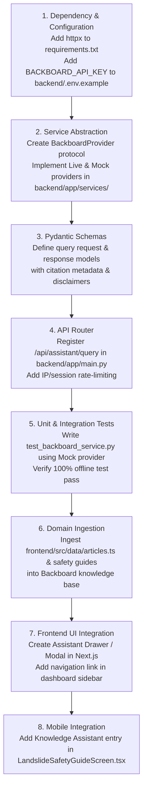

# PahaarPulse — Read-Only Codebase Audit for Backboard.io RAG Integration

**Target System:** PahaarPulse Landslide Risk Management Platform  
**Repository Root:** `C:/Users/Swapnanil/Desktop/app2/LRMSG/LRM`  
**Mobile Subsystem:** `C:/Users/Swapnanil/Desktop/app2/landslide-app`  
**Date of Audit:** October 23, 2026  
**Audit Purpose:** Prepare the existing codebase for integration with Backboard.io as an intelligent landslide knowledge assistant using Retrieval-Augmented Generation (RAG).  
**Operational Status:** READ-ONLY AUDIT COMPLETED. No source files modified, no dependencies installed, no databases mutated.

---

## 1. Repository Summary & Detected Architecture

PahaarPulse is a multi-tier mountain landslide intelligence and emergency management system consisting of two primary codebases:

1. **Central Server & Administration Web Dashboard (`LRMSG/LRM`):**
   - **Backend Framework:** FastAPI (Python 3.12, Uvicorn, Pydantic).
   - **Database:** PostgreSQL 16 with PostGIS 3.4 spatial extensions, orchestrated locally via Docker Compose (`docker-compose.yml`), managed via SQLAlchemy 2.0 ORM and Alembic migrations.
   - **Frontend Framework:** Next.js 16.3.4 (React 19.2.8, TypeScript 5, Tailwind CSS v4, Lucide React).
   - **Routing Architecture:** 100% Next.js App Router (`frontend/src/app/`). No legacy Pages Router (`pages/`) exists.
   - **AI/ML Subsystems:**
     - Numerical Risk Prediction: XGBoost tree models and GIS spatial analysis pipelines (`backend/app/services/spatial_analysis.py`).
     - Vision Hazard Screening: Gemma/Gemini Multimodal VLM pipeline orchestrating field photograph screening (`backend/app/services/gemma_analysis_service.py`).
2. **Mobile Application Subsystem (`landslide-app`):**
   - **Framework:** React Native 0.76.7 with Expo ~52.0.0 (TypeScript).
   - **Offline Infrastructure:** Custom offline synchronization queue (`landslide-app/src/services/sync/syncQueue.ts`) and local AsyncStorage persistence.

---

## 2. Actual Source File Inventory for Integration

The following primary files represent the active architecture and define the boundary for Backboard RAG integration:

| Component | Repository-Relative Path | Architectural Purpose | Integration Role |
| :--- | :--- | :--- | :--- |
| **Backend** | `backend/app/main.py` | FastAPI entry point, CORS, and router registration | Router registration point for `/api/assistant` |
| **Backend** | `backend/app/api/deps.py` | Security guard and coordinator API key verification | Security reference for administrative access |
| **Backend** | `backend/app/api/endpoints/field_reports.py` | Observation CRUD and photo multipart handler | Pattern for FastAPI service orchestration |
| **Backend** | `backend/app/api/endpoints/health.py` | Service health probes | Reference for Backboard health monitoring |
| **Backend** | `backend/app/services/gemma_analysis_service.py` | AI orchestration service | Blueprint for `BackboardService` |
| **Backend** | `backend/app/services/gemma_providers.py` | Provider protocol and exception hierarchy | Blueprint for `BackboardProvider` abstraction |
| **Backend** | `backend/app/services/photo_storage_service.py` | File storage adapter and mime validation | Blueprint for future PDF/doc upload validation |
| **Backend** | `backend/app/database/base.py` | SQLAlchemy engine and session dependency | Session dependency for thread persistence |
| **Backend** | `backend/app/database/config.py` | Environment variable loader via python-dotenv | Pattern for loading `BACKBOARD_API_KEY` |
| **Backend** | `backend/app/database/models.py` | SQLAlchemy entity definitions | Schema reference; demonstrates existing entities |
| **Frontend** | `frontend/src/lib/api.ts` | API base URL resolver and fetch client | Client fetch gateway for web assistant |
| **Frontend** | `frontend/src/app/api/field-reports/[id]/review/route.ts` | Next.js App Router BFF Route Handler | Pattern for server-side proxying and secret shielding |
| **Frontend** | `frontend/src/app/dashboard/layout.tsx` | Dashboard navigation layout | Navigation registration for Assistant UI |
| **Frontend** | `frontend/src/data/articles.ts` | Curated landslide science articles | Initial domain knowledge corpus for RAG |
| **Mobile** | `landslide-app/src/services/api/apiConfig.ts` | Mobile API endpoints and dynamic host resolution | Registration point for mobile assistant route |
| **Mobile** | `landslide-app/src/screens/LandslideSafetyGuideScreen.tsx` | Mobile safety guidelines screen | Candidate screen for mobile assistant entry |

---

## 3. Authentication & Session Findings

A thorough review of `backend/app/api/deps.py`, `backend/app/database/models.py`, `frontend/src/app/api/`, and `landslide-app/src/screens/ProfileLoginScreen.tsx` revealed the following critical findings:

1. **Absence of User Authentication:**
   - There is currently **no user registration, login, session cookie, or JWT token verification** implemented on the FastAPI backend.
   - The PostgreSQL `users` table exists in `backend/app/database/models.py` (`id`, `name`, `phone`, `email`, `role`, `is_verified`), but no authentication endpoints (`/auth/login`, `/auth/register`) exist.
   - Mobile `ProfileLoginScreen.tsx` is an entirely offline mock UI with hardcoded profiles and simulated timeouts.
2. **Coordinator Administrative Guard:**
   - Administrative mutations (shelter approvals, coordination updates, alert thresholds) are protected by `verify_coordinator_authorization` in `backend/app/api/deps.py`.
   - This guard checks for a single, shared static secret (`COORDINATOR_API_KEY`) passed in the `X-Coordinator-Key` or `Authorization: Bearer <key>` header.
   - In production environments, it enforces a strict fail-closed policy (returning HTTP 503 if unconfigured).
3. **Public / Citizen Access:**
   - Public reporting, emergency requests, alert viewing, and GIS road-impact queries are completely open and unauthenticated.
   - **Implication for Backboard RAG:** A public-facing landslide safety assistant can operate anonymously (ephemeral sessions), but user-specific conversation history cannot be securely bounded without implementing a user authentication subsystem.

---

## 4. Database, Dependencies & Runtime Assumptions

- **Python Runtime:** Python 3.12 on Windows / Linux containers.
- **Backend Dependencies (`backend/requirements.txt`):**
  - `fastapi`, `uvicorn`, `pydantic`
  - `sqlalchemy>=2.0,<3`, `psycopg2-binary>=2.9,<3`, `alembic>=1.14,<2`
  - `requests>=2.32,<3`, `earthengine-api>=1.6,<2`
  - `pandas`, `numpy`, `scikit-learn`, `xgboost`, `pytest`
- **Node.js Runtime:** Node.js 20+ / 24+
- **Frontend Dependencies (`frontend/package.json`):**
  - `next`: 16.3.4 (App Router)
  - `react`: 19.2.8, `react-dom`: 19.2.8
  - `lucide-react`: ^1.41.0, `framer-motion`: ^13.2.0, `idb`: ^8.0.3
- **Mobile Dependencies (`landslide-app/package.json`):**
  - `expo`: ~52.0.0, `react-native`: 0.76.7
- **Database Migrations:** 7 Alembic migrations currently applied in PostgreSQL. Any new persistence for chat threads requires an 8th Alembic migration (`20261024_0000_008_chat_threads.py`).

---

## 5. Proposed Backboard Integration Map

Based strictly on observed codebase evidence, the safest integration points are:

### 1. Backboard Client Configuration
* **Location:** `backend/app/services/backboard/config.py` (or `backend/app/core/config.py`).
* **Environment Variables:**
  * `BACKBOARD_API_KEY`: Secret string (backend-only, stored in `backend/.env`).
  * `BACKBOARD_BASE_URL`: String (`https://api.backboard.io` by default).
  * `BACKBOARD_ASSISTANT_ID` / `BACKBOARD_PROJECT_ID`: Identifier for the landslide knowledge assistant.
  * `BACKBOARD_TIMEOUT_SECONDS`: Integer (default: 30).
* **Evidence:** Follows `backend/app/database/config.py` and `backend/app/services/gemma_providers.py`, which use `dotenv.load_dotenv` and `os.environ.get`.

### 2. Dedicated RAG Service Layer
* **Location:** `backend/app/services/backboard_service.py` (with supporting provider protocol in `backend/app/services/backboard/providers.py`).
* **Architecture:**
  * Abstract `BackboardProvider` Protocol defining `async def query(...) -> BackboardQueryResult`.
  * `LiveBackboardProvider` invoking Backboard.io REST/WebSocket API via an asynchronous HTTP client (`httpx.AsyncClient`).
  * `MockBackboardProvider` returning deterministic responses for offline regression tests without requiring live internet or active API keys.
* **Evidence:** Directly mirrors the battle-tested pattern in `backend/app/services/gemma_analysis_service.py` and `backend/app/services/gemma_providers.py`.

### 3. API Endpoint Registration
* **Endpoint File:** `backend/app/api/endpoints/assistant.py`.
* **Registration Point:** `backend/app/main.py`:
  ```python
  from backend.app.api.endpoints.assistant import router as assistant_router
  app.include_router(assistant_router, prefix="/api/assistant", tags=["assistant"])
  ```
* **Endpoints:**
  * `POST /api/assistant/query`: Submit a user prompt, returning structured answers with document citations.
  * `POST /api/assistant/threads`: Initialize an isolated conversation thread.
  * `GET /api/assistant/threads/{thread_id}`: Retrieve thread history.

### 4. Conversation Thread Association Strategy
* **Phase 1 (Anonymous / Ephemeral):** Client generates a UUIDv4 session identifier stored in `localStorage` / `AsyncStorage` and passes it via `X-Session-ID`. The backend routes queries to the corresponding Backboard thread ID cached with a TTL.
* **Phase 2 (Authenticated / Persistent):** Add a `chat_threads` PostgreSQL table linked to `users.id` once true user authentication is established.

### 5. Frontend & Mobile Request Routing
* **Web Frontend:** Call `apiFetch<AssistantQueryResponse>("/api/assistant/query", ...)` in `frontend/src/lib/assistant.ts` via `frontend/src/lib/api.ts`.
* **Next.js BFF Proxy Route:** Optional `frontend/src/app/api/assistant/query/route.ts` mirroring `frontend/src/app/api/field-reports/[id]/review/route.ts` for browser-origin verification and rate-limiting.
* **Mobile App:** Call via `landslide-app/src/services/api/client.ts` with route registered in `landslide-app/src/services/api/apiConfig.ts`.

### 6. Response Normalization & Grounded Citations
* **Schema File:** `backend/app/api/schemas/assistant.py`.
* **Fields:**
  * `reply_text`: Sanitized markdown string.
  * `sources`: List of `{ title: str, source_type: str, url_or_slug: str, snippet: str, score: Optional[float] }`.
  * `disclaimer`: Standard disclaimer: *"PahaarPulse Assistant provides general educational and safety guidance based on documented landslide science. It does not replace real-time emergency orders from district authorities or on-site geotechnical engineering inspections."*

### 7. Rate Limits, Timeouts & Error Handling
* **Timeouts:** 30-second upper bound enforced on upstream HTTP client.
* **Rate Limits:** Route-level dependency (e.g., 10 queries/minute per IP/session) to protect against API quota exhaustion.
* **Error Classes:** `BackboardTimeoutError`, `BackboardRateLimitError`, `BackboardAPIError` caught in the endpoint to return graceful HTTP 504/429/502 with fallback static advice.

### 8. Pipeline Separation & Decoupling
* **Numerical Prediction:** Real-time GIS and XGBoost calculations (`/prediction`) remain completely decoupled from RAG. The ML risk engine will never invoke the LLM.
* **Visual Hazard Screening:** Gemma Multimodal vision (`/api/field-reports`) remains an independent geotechnical screening tool.
* **Knowledge RAG:** Strictly an informational assistant querying curated domain documents (`frontend/src/data/articles.ts`, safety guidelines, standard operating procedures).

---

## 6. Security and Privacy Assessment

| Audit Item | Status | Code Evidence & Technical Rationale |
| :--- | :--- | :--- |
| **1. Back-end-only secret configuration** | `VERIFIED` | In `backend/app/database/config.py` and `gemma_providers.py`, secrets are read via `os.environ.get()` and never bundled to clients. In Next.js, only `NEXT_PUBLIC_` variables reach browsers. |
| **2. Backboard API key shielded from browser/mobile** | `VERIFIED` | If configured in `backend/.env` (or Next.js server runtime without `NEXT_PUBLIC_`), the secret is never exposed. Mobile clients communicate only with FastAPI or BFF proxy. |
| **3. Existing authentication provides reliable user identity** | `MISSING` | No user login, session tokens, or JWT verification exists. Only a shared static `COORDINATOR_API_KEY` exists for admin routes in `backend/app/api/deps.py`. |
| **4. Conversation ownership enforcement** | `MISSING` | Because user identity is absent, conversation threads cannot be cryptographically associated with or restricted to a specific authenticated human. |
| **5. Cross-user conversation access prevention** | `MISSING` | If thread history endpoints accept an unauthenticated `thread_id` UUID, any caller knowing that UUID could query that conversation history. Must use unguessable UUIDv4 + rate limits or defer persistence until user auth is added. |
| **6. Request size and rate limits** | `PARTIALLY_IMPLEMENTED` | `photo_storage_service.py` enforces 10 MB and chunked streaming, but FastAPI endpoints (`main.py`) lack global rate limiting and request body size caps for JSON endpoints. |
| **7. Logging credential & PII exposure** | `PARTIALLY_IMPLEMENTED` | Secrets are compared with `secrets.compare_digest` and not logged. However, unhandled exceptions in `gemma_analysis_service.py` use `logger.error(..., exc_info=True)` which could output local variables if not guarded. |
| **8. Access control on uploaded documents** | `MISSING` | `backend/app/main.py` lines 53-56 mounts `/uploads` via `StaticFiles`. Any uploaded file is publicly accessible over HTTP to anyone with the filename. |
| **9. External API failure resilience** | `VERIFIED` | The existing Gemma AI architecture (`gemma_analysis_service.py`, `gemma_providers.py`) demonstrates fail-safe handling with custom exceptions, fallback providers, and non-blocking background tasks. |
| **10. Untrusted document and output handling** | `PARTIALLY_IMPLEMENTED` | Structured Pydantic validation is strictly enforced (`GemmaHazardOutput`), but no markdown sanitization or XSS escaping is applied to retrieved RAG text before rendering in frontend components. |

---

## 7. Prioritized Compatibility & Implementation Risks

### Confirmed Problems (Must Address in Implementation Plan)
1. **No User Authentication (High Priority):** Client conversations cannot be owned by authenticated users. Must design the initial assistant as an anonymous/ephemeral session system or implement user authentication first.
2. **Missing Rate Limiting (Medium Priority):** Without rate-limiting middleware on FastAPI, public assistant endpoints could be spammed, exhausting Backboard.io API credit limits.
3. **Missing HTTP Client in Backend Dependencies (Low Priority):** `httpx` or `aiohttp` is not currently in `backend/requirements.txt` (`requests` is synchronous). An asynchronous HTTP client (`httpx>=0.27`) must be added to `requirements.txt`.

### Unverified Risks (Requires Backboard.io Clarification)
1. **Streaming vs. Non-Streaming Support:** If Backboard.io responses are streamed via Server-Sent Events (SSE), FastAPI and the Next.js client must implement `StreamingResponse`.
2. **Knowledge Base Ingestion Mechanism:** Need to confirm whether Backboard supports automated REST document ingestion or requires pre-indexing via the Backboard web dashboard.
3. **Latency Upper Bounds:** Upstream RAG response latency must be confirmed to ensure it fits comfortably within the 30-second mobile timeout (`landslide-app/src/services/api/apiConfig.ts`).

---

## 8. Recommended Implementation Sequence



---

## 9. Verification Commands for Existing Test Suites

To verify that the existing codebase remains completely intact and passing:

1. **Backend Regression Test Suite (273 tests):**
   ```powershell
   cd C:/Users/Swapnanil/Desktop/app2/LRMSG/LRM
   $env:PYTHONPATH="."
   python -m unittest discover -s backend/tests -p "test_*.py"
   ```
   *Expected Output:* `Ran 273 tests in ~1.8s, OK`

2. **Mobile Regression Test Suite (17 tests):**
   ```powershell
   cd C:/Users/Swapnanil/Desktop/app2/landslide-app
   node src/__tests__/run-mobile-tests.mjs
   ```
   *Expected Output:* `pass 17, fail 0`

---

## 10. Open Questions for Backboard Integration Planning

1. Does the Backboard.io assistant support REST polling, Server-Sent Events (SSE), or WebSockets for token streaming?
2. How are source documents attributed in Backboard API responses (e.g. chunk offsets, file metadata, relevance scores)?
3. Does Backboard require document chunking on the client side, or does it ingest full Markdown/JSON files directly?
4. What are the rate limits and concurrent request quotas enforced on the Backboard project tier?
