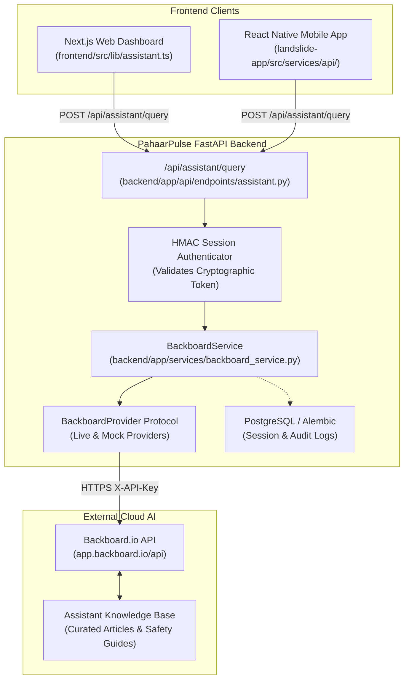

# PahaarPulse — Backboard.io RAG Integration Technical Specification

**Phase:** Phase 1 — Architecture & Integration Specification  
**Project:** PahaarPulse Landslide Knowledge Assistant  
**Date:** October 23, 2026  
**Status:** SPECIFICATION READY FOR REVIEW  

---

## 1. System Architecture & Boundaries

The PahaarPulse Landslide Knowledge Assistant is integrated as a secure, brokered service through the existing FastAPI backend.



### Architectural Safeguards
1. **Zero Secret Exposure:** The `BACKBOARD_API_KEY` resides strictly in the backend environment (`backend/.env`). Neither the web browser nor the mobile application ever receives or requests this key.
2. **Strict Pipeline Decoupling:** The RAG assistant is purely informational. It has no write access to incident dispatch, emergency requests, alert engine thresholds, or GIS numerical susceptibility calculations.

---

## 2. Conversation Ownership & Privacy Strategy

Because the application currently lacks an end-user login system, client-supplied UUIDs or raw Backboard `thread_id` values **must never be trusted**. Knowledge of a thread ID cannot confer access.

### Cryptographic Session Token Design (HMAC-SHA256)
To ensure conversation isolation without trusting client claims, the backend issues a tamper-proof session token:

1. **Token Generation on Thread Creation:**
   * When a client starts a conversation via `POST /api/assistant/threads`, the backend calls Backboard to initialize a new thread (`thread_id`).
   * The backend constructs a session payload:
     $$\text{payload} = \{\text{session\_id}: \text{uuid}, \text{thread\_id}: \text{uuid}, \text{created\_at}: \text{iso8601}, \text{expires\_at}: \text{iso8601}\}$$
   * The backend signs the payload using `SESSION_SIGNING_KEY` with HMAC-SHA256:
     $$\text{token} = \text{base64url}(\text{payload}) \,\|\, \text{"."} \,\|\, \text{base64url}(\text{HMAC}(\text{payload}))$$
2. **Client Storage:**
   * **Web:** Stored in an `HttpOnly`, `SameSite=Strict`, `Secure` cookie named `pp_assistant_session` (mitigating XSS theft).
   * **Mobile:** Stored securely in Expo `SecureStore`.
3. **Server-Side Verification on Every Query:**
   * For every request to `POST /api/assistant/query`, the backend verifies the HMAC signature using constant-time comparison (`secrets.compare_digest`).
   * The backend checks expiration (`expires_at < current_time`).
   * **The backend extracts the bound `thread_id` directly from the validated token.**
   * The client is **never allowed to supply a `thread_id` in the request body**.
4. **Shared Assistant Privacy Controls:**
   * **Assistant Memory Policy:** Backboard's memory extraction is **strictly disabled** (`memory: "off"`).
   * **Threat Addressed:** In a shared assistant, if `memory: "Auto"` were enabled, personal details mentioned by User A could be indexed into assistant memory and surfaced to User B. Disabling memory guarantees complete conversational isolation across threads.
5. **Upgrade Path to Authentication:**
   * Once full user authentication is implemented, the session token will incorporate `user_id`. An Alembic migration will persist threads in an `assistant_threads` table with a foreign key to `users.id`.

---

## 3. Backend Module Specifications

### A. Configuration Module: `backend/app/services/backboard/config.py`
```python
import os
from pathlib import Path
from dotenv import load_dotenv

_backend_dir = Path(__file__).resolve().parents[3]
load_dotenv(_backend_dir / ".env")

class BackboardSettings:
    """Configuration for Backboard RAG Knowledge Assistant."""
    API_KEY: str = os.environ.get("BACKBOARD_API_KEY", "").strip()
    BASE_URL: str = os.environ.get("BACKBOARD_BASE_URL", "https://app.backboard.io/api").rstrip("/")
    ASSISTANT_ID: str = os.environ.get("BACKBOARD_ASSISTANT_ID", "").strip()
    TIMEOUT_SECONDS: float = float(os.environ.get("BACKBOARD_TIMEOUT_SECONDS", "30.0"))
    SESSION_SIGNING_KEY: str = os.environ.get("SESSION_SIGNING_KEY", "").strip()
    SESSION_EXPIRY_HOURS: int = int(os.environ.get("SESSION_EXPIRY_HOURS", "24"))

settings = BackboardSettings()
```

### B. Schemas: `backend/app/api/schemas/assistant.py`
```python
from pydantic import BaseModel, Field
from typing import List, Optional
from uuid import UUID

class AssistantThreadCreateResponse(BaseModel):
    session_token: str
    expires_at: str

class AssistantQueryRequest(BaseModel):
    query: str = Field(..., min_length=2, max_length=1000, description="User question")

class SourceCitation(BaseModel):
    title: str
    document_id: str
    url_or_slug: Optional[str] = None
    category: Optional[str] = None

class AssistantQueryResponse(BaseModel):
    reply: str
    sources: List[SourceCitation]
    disclaimer: str = (
        "PahaarPulse Assistant provides general educational and safety guidance based on "
        "documented landslide science. It does not replace real-time emergency orders from "
        "district authorities or on-site geotechnical engineering inspections."
    )
    fallback_mode: bool = False
```

### C. Provider Interface: `backend/app/services/backboard/providers.py`
```python
from typing import Protocol, List, Dict, Any, Optional

class BackboardProvider(Protocol):
    """Abstract protocol for Backboard API interactions."""
    async def create_thread(self, assistant_id: str) -> str:
        """Create a new thread and return thread_id."""
        ...

    async def send_message(
        self,
        thread_id: str,
        assistant_id: str,
        content: str,
    ) -> Dict[str, Any]:
        """Send user message and return Backboard response dict."""
        ...
```

### D. Service Layer: `backend/app/services/backboard_service.py`
Orchestrates cryptographic session validation, rate limiting, provider calls, citation enrichment, and fallback handling.

---

## 4. API Endpoints Specification

### 1. `POST /api/assistant/threads`
* **Purpose:** Initialize a new isolated conversation thread and receive a signed session token.
* **Authentication:** Public (rate-limited to 5 requests/minute per IP).
* **Request Body:** None.
* **Response Status:** `201 Created`
* **Response Body:** `AssistantThreadCreateResponse` (sets `pp_assistant_session` HttpOnly cookie on web).

### 2. `POST /api/assistant/query`
* **Purpose:** Submit a question to the assistant within the verified thread session.
* **Authentication:** Cryptographic session token required (via Cookie or `Authorization: Bearer <token>`).
* **Request Body:** `AssistantQueryRequest` (`{"query": "What are warning signs of slope failure?"}`).
* **Response Status:** `200 OK`
* **Response Body:** `AssistantQueryResponse`.
* **Error Behaviors:**
  * `401 Unauthorized`: Missing, expired, or tampered session token.
  * `429 Too Many Requests`: Exceeded 10 queries/minute per session.
  * `504 Gateway Timeout`: Backboard took >30s; returns friendly fallback advice.
  * `502 Bad Gateway`: Backboard unavailable; returns conservative emergency guidance.

---

## 5. Client Integration Strategy

### Next.js Web Dashboard (`frontend/src/lib/assistant.ts`)
* Uses existing [`apiFetch<T>`](file:///C:/Users/Swapnanil/Desktop/app2/LRMSG/LRM/frontend/src/lib/api.ts#L27) wrapper with credentials (`credentials: "same-origin"`).
* Automatic cookie handling ensures zero token management in JavaScript.
* Navigation: Link added to [`frontend/src/app/dashboard/layout.tsx`](file:///C:/Users/Swapnanil/Desktop/app2/LRMSG/LRM/frontend/src/app/dashboard/layout.tsx) under *Knowledge Assistant*.

### Mobile Application (`landslide-app/src/services/api/assistantApi.ts`)
* Calls backend endpoints via [`apiClient`](file:///C:/Users/Swapnanil/Desktop/app2/landslide-app/src/services/api/client.ts).
* Stores `session_token` in `expo-secure-store`.
* UI Entry: Interactive card embedded in [`LandslideSafetyGuideScreen.tsx`](file:///C:/Users/Swapnanil/Desktop/app2/landslide-app/src/screens/LandslideSafetyGuideScreen.tsx).
