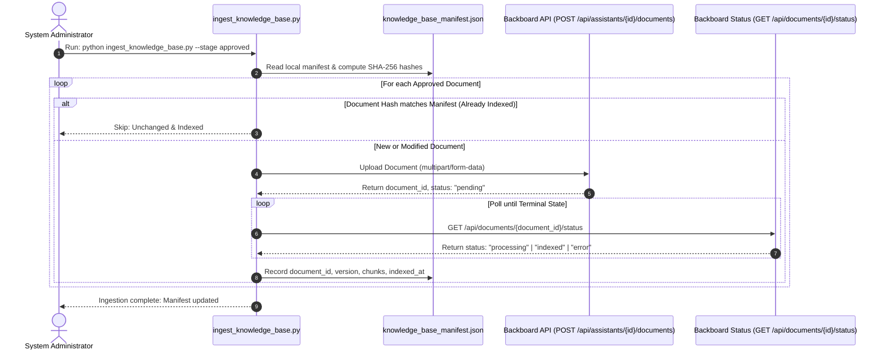

# PahaarPulse — Backboard Knowledge Base Ingestion Plan

**Phase:** Phase 1 — Knowledge Base Ingestion Specification  
**System Target:** PahaarPulse Landslide Knowledge Assistant  
**Date:** October 23, 2026  
**Status:** PROPOSAL & MANIFEST GATING SPECIFICATION  

---

## 1. Domain Knowledge Corpus Assessment

PahaarPulse currently contains a curated set of 6 foundational scientific articles authored by the internal research team located in [`frontend/src/data/articles.ts`](file:///C:/Users/Swapnanil/Desktop/app2/LRMSG/LRM/frontend/src/data/articles.ts). These articles summarize physical landslide mechanisms, triggering factors, geospatial modeling, and early warning protocols.

In addition, the mobile application provides structured safety guidelines in [`LandslideSafetyGuideScreen.tsx`](file:///C:/Users/Swapnanil/Desktop/app2/landslide-app/src/screens/LandslideSafetyGuideScreen.tsx).

---

## 2. Document Manifest Proposal

| Doc ID | Stable Filename | Document Title | Source Organization | Pub Date | Doc Type | Provenance Status | Copyright / License | Intended Use | Ingestion Readiness |
| :--- | :--- | :--- | :--- | :--- | :--- | :--- | :--- | :--- | :--- |
| **DOC-001** | `01_why_do_landslides_happen.md` | Why Do Landslides Happen? Understanding Signals Before Failure | PahaarPulse Research Team | 2026-08-15 | Markdown | Internal Verified | Proprietary / Open Internal | Educational RAG | **APPROVED (Tier 1)** |
| **DOC-002** | `02_how_gis_turns_terrain_data_into_risk_maps.md` | How GIS Turns Terrain Data into Landslide Risk Maps | PahaarPulse Research Team | 2026-08-18 | Markdown | Internal Verified | Proprietary / Open Internal | Technical Q&A | **APPROVED (Tier 1)** |
| **DOC-003** | `03_how_machine_learning_predicts_landslide_risk.md` | How Machine Learning Can Predict Landslide Risk | PahaarPulse Research Team | 2026-08-20 | Markdown | Internal Verified | Proprietary / Open Internal | Technical Q&A | **APPROVED (Tier 1)** |
| **DOC-004** | `04_why_rainfall_and_soil_moisture_matter.md` | Why Rainfall and Soil Moisture Matter for Landslide Risk | PahaarPulse Research Team | 2026-08-22 | Markdown | Internal Verified | Proprietary / Open Internal | Risk Trigger Q&A | **APPROVED (Tier 1)** |
| **DOC-005** | `05_watching_landscape_from_space.md` | Watching the Landscape from Space: Satellites & Monitoring | PahaarPulse Research Team | 2026-08-25 | Markdown | Internal Verified | Proprietary / Open Internal | Satellite & Sensor Q&A | **APPROVED (Tier 1)** |
| **DOC-006** | `06_from_risk_maps_to_early_warning.md` | From Risk Maps to Early Warning: What Happens After Prediction? | PahaarPulse Research Team | 2026-08-28 | Markdown | Internal Verified | Proprietary / Open Internal | Preparedness & Response | **APPROVED (Tier 1)** |
| **DOC-007** | `07_ndma_community_landslide_safety_guidelines.md` | Community Landslide Safety & Evacuation Protocols | National Disaster Management Authority (NDMA) | 2024-05-10 | Markdown | Official Public Guidance | Public Domain / Gov India | Emergency Safety Guidance | **APPROVED (Tier 1)** |
| **DOC-008** | `08_geological_hazard_taxonomy_sop.md` | Mountain Slope Hazard Taxonomy & Identification SOP | PahaarPulse Geotechnical Team | 2026-10-20 | Markdown | Internal Engineering | Proprietary / Project Team | Feature Interpretation | **PENDING REVIEW (Tier 2)** |
| **DOC-009** | `ext_usgs_landslide_hazards_primer.pdf` | USGS Landslide Hazards Program Technical Primer | US Geological Survey | 2023-01-15 | PDF | External Agency | Public Domain (US Gov) | Supplementary Science | **PENDING REVIEW (Tier 2)** |
| **DOC-010** | `raw_telemetry_sensor_logs.csv` | Raw Telemetry Sensor Streams (Soil Moisture / Rain Gauges) | Field IoT Loggers | Real-time | Raw Data | Sensor Logs | Internal Operations | Inappropriate for Text RAG | **REJECTED (Tier 3)** |
| **DOC-011** | `candidate_image_scrape_manifest.csv` | Wikimedia Candidate Image Manifests | Web Harvester | 2026-10-22 | CSV | Intermediate Workflow | Varies | Inappropriate for Text RAG | **REJECTED (Tier 3)** |

---

## 3. Tiered Corpus Categorization

1. **Tier 1 — Approved for Initial Phase 2 Ingestion (7 documents):**
   * The 6 core articles from `frontend/src/data/articles.ts` converted into clean Markdown documents with structured YAML frontmatter.
   * Official NDMA / SDMA Himalayan landslide safety, evacuation, and preparedness guidelines.
2. **Tier 2 — Pending Licensing / Quality Review (2 documents):**
   * Technical geological hazard identification SOPs and external USGS primers requiring explicit copyright verification and geotechnical sign-off before ingestion.
3. **Tier 3 — Prohibited / Unsuitable for Ingestion:**
   * Raw numerical time-series (rainfall/soil sensor streams), raw GeoJSON shapefiles, candidate image scrape logs, civilian SOS reports, or personally identifiable information.

---

## 4. Ingestion Workflow & Tooling

Document ingestion will be managed via a dedicated, idempotent CLI utility: `backend/scripts/ingest_knowledge_base.py`. Ingestion will **never execute automatically during application server startup**.

### Ingestion Controls & Safety Features
1. **Content Hash Verification:** Every document's SHA-256 hash is recorded in `backend/data/knowledge_base_manifest.json`. If a file has not changed, upload is skipped.
2. **Stale Document Cleanup:** If a document is updated, the script deletes the old version using `DELETE /api/documents/{old_id}` before indexing the new version, preventing duplicate chunks.
3. **Polling Backoff:** Checks status every 3 seconds with a 180-second timeout ceiling.
4. **Structured Metadata Extraction:** Formats documents with clean YAML headers (title, category, slug, author) to ensure Backboard's hybrid search engine indexes authoritative source tags.
