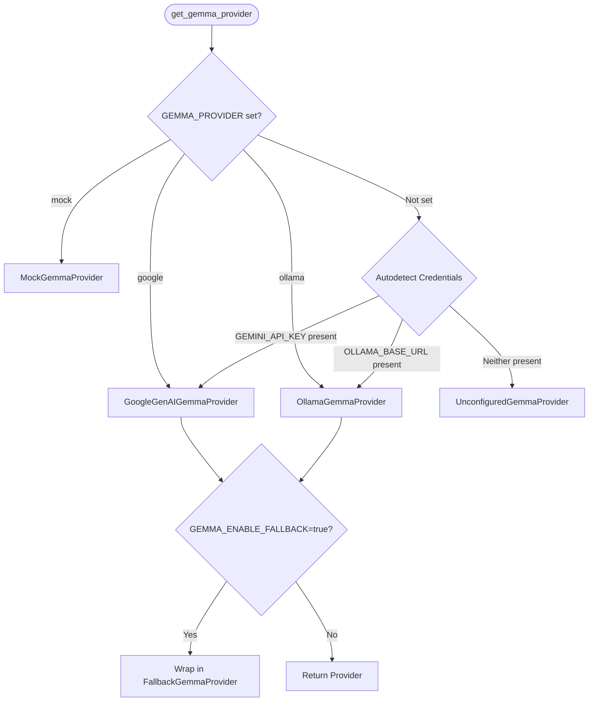

# Architecture Specification — Gemma Local Vision Inference

## 1. System Context & Overview

PahaarPulse is an AI/ML Landslide Risk Management system deployed for hazard assessment in mountainous terrains. The field reporting subsystem ingests ground reports (textual notes, GPS coordinates, timestamps, reporter contacts, and photographs) from mobile applications and web dashboards.

The AI Hazard Screening subsystem acts strictly as an **observational triage assistant**. It does NOT perform autonomous safety clearances or replace qualified geotechnical engineering reviews.

```
       +---------------------------------------------+
       |   Field Report Sources (Web / Mobile App)   |
       +---------------------------------------------+
                              |
                              v
             +----------------------------------+
             |    FastAPI REST Endpoints        |
             |  /api/field-reports [POST / GET] |
             |  /api/field-reports/{id}/analyze |
             +----------------------------------+
                              |
                              v
               +------------------------------+
               |     GemmaAnalysisService     |
               |  (Orchestration & Atomicity) |
               +------------------------------+
                              |
               +--------------+---------------+
               |                              |
               v                              v
    +----------------------+       +----------------------+
    | GoogleGenAIGemma     |       |  OllamaGemmaProvider |
    | Provider (Hosted)    |       |  (Local Vision VLM)  |
    | - gemini-3.5-flash   |       |  - gemma3:4b         |
    +----------------------+       +----------------------+
               |                              |
               +--------------+---------------+
                              |
                              v
             +----------------------------------+
             |    Pydantic Schema Validation    |
             |       (GemmaHazardOutput)        |
             +----------------------------------+
                              |
                              v
             +----------------------------------+
             | PostgreSQL Atomic Persistence    |
             | (field_reports database table)   |
             +----------------------------------+
```

---

## 2. Provider Abstraction Architecture

The provider abstraction is defined via the `AnalysisProvider` Protocol in `backend/app/services/gemma_providers.py`:

```python
class AnalysisProvider(Protocol):
    @property
    def provider_name(self) -> str: ...
    def is_available(self) -> bool: ...
    async def analyze(
        self,
        notes: Optional[str],
        location_name: Optional[str],
        photo_bytes: Optional[bytes] = None,
        photo_mime: Optional[str] = None,
    ) -> GemmaHazardOutput: ...
```

### Implementations:
1. **`GoogleGenAIGemmaProvider` (Hosted):**
   - Calls the Google GenAI SDK (`google-genai`) using `GEMINI_API_KEY`.
   - Sends multimodal requests with `types.Part.from_bytes` for JPEG/PNG/WebP images.
   - Enforces `response_mime_type="application/json"` with temperature 0.2.
   - Active verified model: `gemini-3.5-flash`.

2. **`OllamaGemmaProvider` (Local Vision VLM):**
   - Communicates with an on-premises or localhost Ollama daemon via HTTP REST (`/api/generate`).
   - Active verified model tag: `gemma3:4b`.
   - Passes image data as Base64 strings in the `"images"` array.
   - Uses Ollama `"format": "json"` mode to constrain outputs to strict JSON.
   - Handles network timeouts, missing models (HTTP 404), concurrency saturation (HTTP 429), and temporary service downtime (HTTP 503).

3. **`FallbackGemmaProvider` (Optional Explicit Fallback):**
   - Wraps a primary provider and a secondary provider.
   - Only active if `GEMMA_ENABLE_FALLBACK=true`.
   - Preserves provenance of which provider generated the result.

4. **`MockGemmaProvider` (Test / Offline Development):**
   - In-memory deterministic heuristic engine for unit testing and CI/CD pipelines.

5. **`UnconfiguredGemmaProvider` (Null Safety):**
   - Returned when neither hosted credentials nor local runtimes are present.
   - Raises `GemmaProviderUnavailableError` without crashing the application.

---

## 3. Provider Selection & Environment Flow

Provider resolution is configuration-driven through `get_gemma_provider()`:



---

## 4. Evidence-Grounded Prompting & Safety Boundaries

The `SYSTEM_PROMPT` enforces strict geotechnical screening boundaries:
1. **Separation of Evidence:** Direct physical visual evidence in the photograph is separated from observer assertions in the notes.
2. **Conservative Triage:** Ambiguous, obscured, or incomplete views MUST default to `"indeterminate"`.
3. **No Safety Clearances:** The model is prohibited from declaring an area "safe" or "cleared" based on observer claims.
4. **Uncalibrated Confidence:** The confidence score represents model self-assessed clarity, explicitly labeled as uncalibrated.
5. **Observational Limitations:** Image lighting, angle, and distance constraints are captured in `limitations`.

---

## 5. Human-Review Boundary

The AI pipeline is strictly decoupled from the final administrative review:
- AI screening populates `ai_hazard_level`, `ai_detected_hazards`, `ai_confidence`, `ai_summary`, and `ai_analyzed_at`.
- It NEVER alters `review_status` (which remains `pending` until human intervention).
- Human coordinators retain sole authority to verify, action, or reject reports via `PATCH /api/field-reports/{id}/review`.
