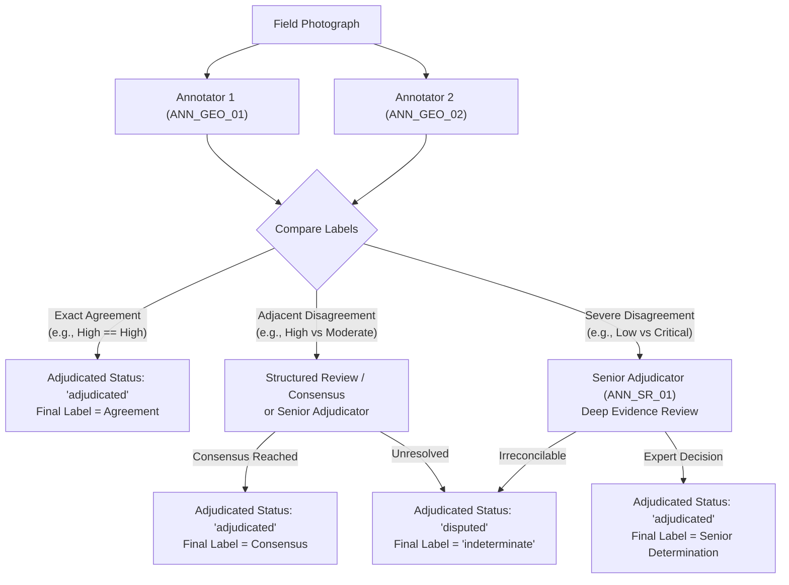

# Ground-Truth Annotation & Adjudication Protocol for Field-Photo Landslide Screening

**Document Version:** 1.0.0  
**Effective Date:** October 2026  
**System Scope:** PahaarPulse AI Field Intelligence — Multimodal Vision Screening Subsystem  
**Application Target:** Ground-Level and Oblique RGB Field Photographs (Himalayan Terrain)

---

## 1. Scientific Objective & Target Task Differentiation

The goal of this protocol is to define an evidence-grounded, reproducible ground-truth annotation process for visual field photographs of slope instability and landslide hazards.

### Critical Boundary: Triage vs. Geotechnical Prognosis
Field-photo screening models and geotechnical stability models perform fundamentally distinct tasks. Annotators and researchers must maintain strict demarcation between these three targets:

```
+---------------------------------------------------------------------------------------------------------+
|                                    TARGET TASK DIFFERENTIATION                                         |
+------------------------------------+------------------------------------+-------------------------------+
| Target 1: Observable Indicators    | Target 2: Visual Triage Severity   | Target 3: Failure Probability |
+------------------------------------+------------------------------------+-------------------------------+
| Strictly visible physical features | Operational inspection priority    | Quantitative actuarial risk   |
| manifested on the surface (e.g.,   | derived from observable evidence   | requiring subsurface boring,  |
| tension cracks, scarps, rockfall,  | and immediate threat to transport/ | pore-water pressure, shear    |
| road blockage, toe erosion).       | human safety.                      | strength, and rainfall data.  |
|                                    |                                    |                               |
| -> TARGET OF THIS BENCHMARK        | -> TARGET OF THIS BENCHMARK        | -> OUT OF SCOPE FOR PHOTOS    |
+------------------------------------+------------------------------------+-------------------------------+
```

> [!IMPORTANT]
> **No photograph alone can establish subsurface factor of safety (FoS) or a calibrated mathematical probability of future slope failure.** An image captures only superficial geometry and surface manifestations at a single instant. The evaluation target of this benchmark is strictly **Target 1 (Observable Indicators)** and **Target 2 (Visual Triage Severity)**.

---

## 2. Image Intake, Provenance & Integrity Specifications

Each benchmark photograph must be recorded with verifiable provenance and cryptographic integrity before entering the annotation pipeline.

### 2.1 Cryptographic Identification
- **`image_id`:** System-wide unique identifier using format `FPB_<REGION>_<YYYYMMDD>_<HASH8>` (e.g., `FPB_UK_20260714_8A3F12C9`).
- **`image_sha256`:** Full 64-character lowercase hexadecimal SHA-256 digest computed across raw image bytes:
  $$\text{SHA256}(\text{bytes}) = \text{hash}$$
  Used to detect duplicate images across splits and ensure absolute tamper-evidence.

### 2.2 Provenance & Permission Standards
- **Source Agency / Institution:** Documented origin (e.g., State Disaster Management Authority, Geological Survey, Border Roads Organisation, academic field survey, verified citizen report).
- **License / Permission Status:** Every image must possess documented legal redistribution rights:
  - Permitted: Open Government Licence (OGL), Creative Commons Attribution (CC BY 4.0), explicit written institutional data sharing agreement, or project-consented field submission.
  - Strictly Prohibited: Unverified public web scrape, copyright-reserved photographs without license, or Zenodo/academic records with blank/unspecified license fields.

### 2.3 Acquisition Metadata (Non-Personally Identifiable)
- **Capture Date & Time:** Approximate UTC or local timestamp.
- **Geographic Domain:** District and state level (e.g., *Chamoli, Uttarakhand* or *East Sikkim*).
- **Terrain Context:** Slope angle estimate, road type (National Highway, rural road, settlement perimeter).
- **Environmental Context:** Monsoonal heavy rain, dry post-failure, winter freeze-thaw, active excavation.

---

## 3. Image Suitability & Exclusion Criteria

Photographs must undergo an initial quality screen before expert annotation.

### 3.1 Quality Tiers
| Quality Tier | Criteria | Evaluation Eligibility |
| :--- | :--- | :---: |
| **`excellent`** | High resolution ($\ge 1920\times 1080$), sharp focus, optimal lighting, comprehensive slope view including crest and toe. | **Eligible** |
| **`adequate`** | Standard resolution ($\ge 800\times 600$), minor motion blur or glare, key slope features clearly discernable. | **Eligible** |
| **`degraded`** | Low resolution, rain streaks, distance blur, or partial shadow; indicators identifiable only with difficulty. | **Eligible (Stratified)** |
| **`obscured`** | Dense fog, night without illumination, severe lens obstruction; insufficient visual information. | **Eligible (Must be Ground-Truth `indeterminate`)** |

### 3.2 Hard Exclusion Criteria
Photographs meeting any of the following criteria are excluded from model scoring and assigned an explicit `exclusion_reason`:
1. **`non_slope_scene`:** Indoor photographs, close-ups of documents, non-geotechnical objects.
2. **`severe_privacy_violation`:** Unredacted recognizable human faces or vehicle license plates.
3. **`duplicate_artifact`:** Exact byte duplicate or cropped sub-region of an already cataloged image.
4. **`synthetic_or_tampered`:** AI-generated imagery, watermarked stock imagery, or misleading digital edits.

---

## 4. Standardized Annotation Taxonomy

Annotators must evaluate two distinct dimensions: visible physical indicators and overall triage severity.

### 4.1 Dimension A: Standardized Observable Indicators (`observable_indicators`)
Annotators record all observed indicators as a semicolon-separated list:

1. **`tension_cracks`:** Linear fractures or en echelon fissures at the slope crest or crown indicating active tensile strain.
2. **`slope_displacement`:** Noticeable vertical or horizontal shear scarps, hummocky topography, tilted trees/poles (pistol-butted trunks).
3. **`road_blockage`:** Debris, mud, or boulders covering part or all of a vehicular roadway.
4. **`rockfall_debris`:** Detached angular rock fragments, talus cones, or boulder accumulation at the slope base.
5. **`structural_damage`:** Cracked retaining walls, sheared culverts, undermined road foundations, or damaged buildings.
6. **`toe_erosion`:** Undercutting of slope foot by river discharge, drain runoff, or road cutting.
7. **`mudflow`:** Water-saturated slurry flow exhibiting fluid flow structures or debris channels.
8. **`water_seepage`:** Active groundwater daylighting, piping, wet patches on dry slope face, or surface runoff ponding.
9. **`stable_vegetation`:** Undisturbed contiguous forest canopy or mature grass cover showing zero displacement.

### 4.2 Dimension B: Categorical Triage Severity (`adjudicated_label`)
The triage category reflects the urgency of on-site geotechnical inspection and life-safety containment based on visible evidence:

| Triage Class | Geotechnical Interpretation & Observable Criteria | Recommended Response Action |
| :--- | :--- | :--- |
| **`critical`** | Active slope collapse, major debris covering lifeline corridors, sheared structures, wide fresh tension cracks directly threatening inhabited dwellings or active roads. | Immediate evacuation, road closure, rapid deployment of NDRF/SDRF response teams. |
| **`high`** | Significant tension cracks (>5 cm), fresh minor rockfall, toe undercutting, tilted infrastructure, partial road obstruction with evident potential for imminent enlargement. | Priority geotechnical inspection within 6–12 hours; traffic warning signs, debris containment. |
| **`moderate`** | Incipient hair cracks, minor raveling, saturated soil patches, old historical scars with partial vegetative recovery, localized ditch blockage. | Scheduled inspection within 24–48 hours; monitoring of water runoff and slope drainage. |
| **`low`** | Stable slope geometry, mature undisturbed vegetation, functioning engineered retaining structures, no observable cracks or displacement. | Routine seasonal monitoring. |
| **`indeterminate`** | The photograph provides insufficient visual evidence to determine slope condition (heavy fog, extreme distance, occluded toe, contradictory evidence). | Discard or request re-photography from an alternate vantage point with adequate lighting. |

---

## 5. Annotator Qualifications & Independent Dual-Review Workflow

To eliminate single-observer bias, all benchmark ground truth requires independent adjudication by qualified domain experts.

### 5.1 Reviewer Qualifications
- **Primary Annotators (`annotator_1`, `annotator_2`):** Minimum Bachelor’s or Master’s degree in Engineering Geology, Geotechnical Engineering, Civil Engineering, or Remote Sensing/GIS with $\ge 2$ years practical experience in landslide hazard assessment.
- **Senior Adjudicator (`senior_adjudicator`):** Senior engineering geologist or geotechnical specialist with $\ge 7$ years field experience in Himalayan or active tectonic slope stability.
- **Pseudonymity:** Reviewers are assigned persistent anonymous identifiers (`ANN_GEO_01`, `ANN_GEO_02`, `ANN_SR_01`) to protect privacy while preserving auditability.

### 5.2 Independent Blinding Protocol
1. **Blind Review:** Annotators evaluate photographs independently using isolated digital annotation forms.
2. **Model Blindness:** Annotators must **never** see model predictions, AI hazard levels, or automated confidence scores during annotation.
3. **Cross-Annotator Blindness:** Reviewers cannot inspect other annotators' ratings until both independent reviews are locked.

---

## 6. Consensus & Adjudication Rules

Disagreements between independent reviewers are adjudicated systematically:



### 6.1 Adjudication Criteria
1. **Exact Concordance:** If `annotator_1_label == annotator_2_label`, the label is automatically confirmed as `adjudicated_label` with `adjudication_status = "adjudicated"`.
2. **One-Step Disagreement:** (e.g., `moderate` vs. `high`). A structured consensus conference is convened. If consensus cannot be achieved within 5 minutes, a senior adjudicator decides.
3. **Two-Step or Severe Disagreement:** (e.g., `low` vs. `critical` or `low` vs. `high`). The sample is escalated to `senior_adjudicator`. The specific physical evidence cited by both reviewers is documented in `notes`.
4. **Irreconcilable Uncertainty:** If physical evidence is genuinely ambiguous, the sample is assigned `adjudicated_label = "indeterminate"` with `adjudication_status = "disputed"`. It is **never** forced into a determinate class.

---

## 7. Inter-Annotator Agreement Metrics

Before evaluating any machine learning model against the benchmark, the benchmark's internal reliability must be established by reporting inter-annotator agreement statistics across double-annotated samples:

1. **Observed Percent Agreement ($P_o$):**
   $$P_o = \frac{\sum_{i=1}^k n_{ii}}{N}$$
2. **Cohen’s Kappa ($\kappa$):**
   $$\kappa = \frac{P_o - P_e}{1 - P_e}$$
   Where $P_e$ is the expected chance agreement across the 5 categories.
3. **Acceptance Threshold:**
   - $\kappa \ge 0.70$: High reliability; benchmark qualified for model evaluation.
   - $0.50 \le \kappa < 0.70$: Moderate reliability; categories with low agreement must be flagged and re-adjudicated.
   - $\kappa < 0.50$: Unacceptable agreement; guidelines must be refined before model evaluation.

---

## 8. Privacy, Legal & Ethical Safeguards

1. **Facial and PII Redaction:** All photographs featuring recognizable individuals, bystanders, responders, or vehicle license plates must be blurred or cropped prior to hashing and dataset ingestion.
2. **Private Property Coordinates:** Exact residential GPS coordinates must not be published. Metadata reports only district, sub-division, or 10-km grid cells.
3. **No Commercial Exclusivity:** Benchmark datasets must be maintained under non-exclusive, auditable scientific licensing for reproducible public-safety verification.
4. **Integrity Lock:** Once finalized, the benchmark CSV manifest and corresponding image directory are hashed. No sample may be modified, relabeled, or swapped without an incremented document version and full changelog.
