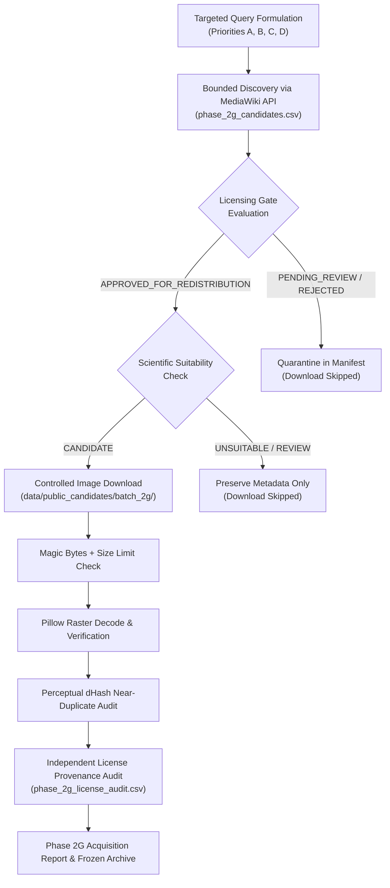

# PahaarPulse — Phase 2G: Controlled Dataset Acquisition & Provenance Validation Plan

**Document Version:** v1.0  
**Effective Date:** 2026-10-23  
**Project:** PahaarPulse AI/ML Landslide Risk Management System  
**Lead Authority:** Senior Computer-Vision Engineer, Geotechnical Data-Quality Researcher, ML Evaluation Specialist, and Backend Safety Engineer  
**Status:** Approved & Enforced Protocol  

---

## 1. Executive Rationale & Scientific Need

The Phase 2F Dataset Coverage and Benchmark Entry-Gate audits revealed critical scientific and operational gaps in the 54-image candidate collection:
1. **Severe Geographic Under-Representation of the Indian Himalayan Region (IHR):** Only 2 of 54 images (3.7%) originated from the IHR (both from a single road-clearing series in Himachal Pradesh). 77.8% of baseline candidates represented European or North American geological environments.
2. **Deficit of Matched Roadside Negative Controls:** Baseline non-landslide controls consisted predominantly of scenic mountain passes (`landscape_pass`) rather than operational highway cut slopes, functional retaining walls, or unobstructed drainage culverts.
3. **Under-Representation of Early Precursor Hazards:** Incipient slope instability markers (fresh tension cracks, road-edge subsidence, crown scarps) accounted for only 3.7% of baseline candidates.
4. **Site-Clustering / Environmental Leakage Risks:** Multiple images were clustered in single geographical events, requiring careful physical isolation and explicit split partitioning.

Phase 2G establishes an evidence-based, protocol-governed acquisition workflow to systematically discover, license-audit, and acquire candidate imagery addressing these four deficits without compromising operational stability or scientific integrity.

---

## 2. Evidence-Based Acquisition Priority Tiers

Acquisition queries and candidate filtering are prioritized into four distinct tiers:

### Priority Tier A: Indian Himalayan Region (IHR) Road Corridors
- **Geographic Focus:** Uttarakhand (NH-58, NH-107, Char Dham corridors), Himachal Pradesh (NH-05 Kinnaur, Kullu-Manali, Shimla), Sikkim (NH-10 Teesta corridor), and Jammu & Kashmir / Ladakh (Zanskar, Srinagar-Leh highway).
- **Target Morphology:** Active debris flows, translational cut-slope failures, road-blocking rockfalls, and monsoonal slope destabilization characteristic of fragile Lesser and Higher Himalayan lithologies (phyllites, schists, weathered gneiss).
- **Minimum Target:** $\ge 25$ candidate records across multiple independent valleys and highway sectors.

### Priority Tier B: Matched Roadside Engineering Negative Controls
- **Physical Focus:** Engineered slopes without active failures, including intact concrete/masonry retaining walls, gabion walls, functional concrete road-side drainage ditches, unobstructed culverts, and pinned rockfall netting.
- **Operational Purpose:** Mitigate visual false positives where the VLM flags steep rock cuts, road curbs, or construction activity as acute landslide emergencies.
- **Minimum Target:** $\ge 20$ candidate records.

### Priority Tier C: Early-Warning Precursor Indicators
- **Geomorphic Focus:** Sub-failure tension cracks in asphalt pavement or unpaved shoulders, minor road-edge subsidence, fresh crest scarps above cut slopes, bulging retaining walls, and sediment-choked culvert inlets.
- **Operational Purpose:** Train and evaluate hazard screening on early warning signs before total slope collapse occurs.
- **Minimum Target:** $\ge 5$ candidate records.

### Priority Tier D: Independent Geographic & Environmental Coverage
- **Spatial Diversity:** Maximizing independent valley systems, elevation zones, and illumination/weather conditions (wet monsoonal conditions, post-storm overcast, dry seasons).
- **Grouping Rules:** Every candidate must be assigned a site cluster ID (`event_site_group`) with confidence scoring (`CONFIRMED_SITE`, `TENTATIVE_GEOGRAPHIC_CLUSTER`, or `UNKNOWN_EVENT_OR_SITE`).

---

## 3. Strict Safety, Security & Isolation Protocols

To protect operational integrity and prevent benchmark data contamination, the following architectural invariants are enforced:

### 3.1 Non-Destructive Operational Isolation
- **Zero Database Mutation:** No database migrations, truncations, reseeding, or table alterations across PostgreSQL tables.
- **Production Storage Isolation:** Under no circumstances may candidate images be written to production upload directories (`backend/uploads/` or `backend_uploads/`). `ControlledImageDownloader._validate_isolated_download_dir()` enforces this at runtime by raising `PublicAcquisitionError` if production paths are targeted.
- **Separate Batch Directory:** All newly acquired Phase 2G candidate images are stored in a dedicated, isolated folder: `data/public_candidates/batch_2g/`. The 54 baseline images in `data/public_candidates/images/` remain strictly immutable.
- **Non-Overwrite Protection:** `ControlledImageDownloader.download_candidate()` checks if the target file already exists on disk. If present, it computes the SHA-256 digest, marks the status `DOWNLOADED`, and preserves the existing file without clobbering or performing redundant network calls.

### 3.2 Network & Content Security (SSRF Mitigation)
- **URL Safety Validation:** Every download and thumbnail URL is validated via `ControlledImageDownloader.validate_safe_url()`:
  - Allowed schemes: strictly `http` and `https`.
  - Blocked targets: `localhost`, `127.0.0.1`, `0.0.0.0`, cloud metadata endpoints (`169.254.169.254`), RFC1918 private subnets (`10.0.0.0/8`, `172.16.0.0/12`, `192.168.0.0/16`), and internal DNS domains (`.internal`, `.local`).
- **File Signature & Raster Verification:**
  - Strict magic byte inspection: JPEG (`\xFF\xD8\xFF`), PNG (`\x89PNG\r\n\x1a\n`), WebP (`RIFF....WEBP`).
  - Strict file size limit: 15.0 MB maximum with atomic temporary file deletion upon violation.
  - In-memory Pillow raster decode verification (`img.verify()` and `img.size` extraction) to prevent corrupt or malformed image persistence.

### 3.3 Separation of Discovery, Manifests, and Benchmarks
- **Versioned Phase 2G Manifest:** Discovery results are stored in `docs/gemma-local-vision/evaluation/phase_2g_candidates.csv` (28-column schema).
- **Independent License Audit:** Source verification results are stored in `docs/gemma-local-vision/evaluation/phase_2g_license_audit.csv` (18-column schema).
- **Benchmark Freezing:** No candidate image from Phase 2G may enter `public_benchmark_draft.csv` or any active evaluation split until dual-expert geotechnical annotations and consensus adjudication are formally completed.

---

## 4. Independent License Verification Protocol

All candidate imagery must satisfy the Phase 2B/2C legal provenance gates:
1. **Redistribution Eligibility Gate:**
   - Permitted without legal review: Creative Commons CC0, CC BY (2.0, 3.0, 4.0), CC BY-SA (2.0, 3.0, 4.0), and confirmed US Government Public Domain (USGS, NPS, USFS).
   - Flagged for Legal Review (`PENDING_REVIEW`): Custom open data licenses (e.g., GODL-India), Flickr Commons ("No known copyright restrictions"), and ambiguous public licenses. These records are quarantined and excluded from automated download.
   - Strictly Rejected (`REJECTED`): Non-commercial clauses (CC BY-NC, CC BY-NC-SA) under public redistribution mode, and all non-derivative clauses (CC BY-ND, CC BY-NC-ND).
2. **Upstream API Audit:**
   - Every candidate ID is queried live against the upstream Wikimedia Commons MediaWiki API (`prop=imageinfo`, `iiprop=url|size|mime|extmetadata|sha1`).
   - License metadata (`LicenseShortName`, `LicenseUrl`, `UsageTerms`, `Artist`, `Credit`) is independently re-verified, and live direct source URLs and file sizes are audited.

---

## 5. Execution Workflow

---

## 6. Formal Benchmark Inference Gate

As mandated by scientific evaluation integrity standards:
- **Benchmark Evaluation Status:** **BLOCKED**
- **Condition for Unblocking:** All candidate images require independent dual-expert geotechnical annotation (Annotator A and Annotator B), inter-rater agreement computation (Cohen's / Fleiss' kappa $\ge 0.70$), and formal consensus adjudication.
- **Model Invariant:** Active production configuration remains `GEMMA_PROVIDER=google` with `GEMMA_MODEL=gemini-3.5-flash`.
