# PahaarPulse — Phase 2H: Safe Evaluation Split & Site-Independence Plan

**Document Version:** v1.0  
**Effective Date:** 2026-10-23  
**Project:** PahaarPulse AI/ML Landslide Risk Management System  
**Lead Authority:** Senior Computer-Vision Engineer, Geotechnical Data-Quality Researcher, ML Evaluation Specialist, and Backend Safety Engineer  
**Status:** Protocol Approved; Split Execution Blocked Pending Annotation  

---

## 1. Architectural Principles & Anti-Leakage Guardrails

A scientifically defensible evaluation benchmark requires that the model is tested on **truly unseen physical sites and environmental regimes**. Splitting photographs by random assignment creates catastrophic data leakage whenever photographs from the same hillside, highway corridor, or photographic sequence appear on both sides of the split.

### 1.1 Non-Negotiable Splitting Rules
1. **Atomic Group Allocation:** Every confirmed multi-image cluster (`CONFIRMED_SITE_EVENT`) identified in [`PHASE_2H_GROUPING_MANIFEST.csv`](file:///C:/Users/Swapnanil/Desktop/app2/LRMSG/LRM/docs/gemma-local-vision/evaluation/PHASE_2H_GROUPING_MANIFEST.csv) must be assigned in its entirety to either the Development split (`dev`) or the Held-Out Test split (`test`). Under no circumstances may images from the same cluster be divided across splits.
2. **Probable Cluster Conservatism:** Records sharing highway corridors or valley systems (`PROBABLE_SITE_EVENT`) must be assigned to the same split or isolated in `dev` to prevent subtle geomorphic leakage into `test`.
3. **Handling of Unknown Sites (`UNKNOWN_SITE_EVENT`):** In accordance with the "Unknown $\ne$ Independent" principle, unknown records may **not** be indiscriminately dumped into the test split. Prior to any unknown candidate entering the held-out test benchmark, it must undergo manual image inspection to verify that it does not depict a location already represented in `dev`.
4. **No Premature Split Assignment:** Actual partition assignment remains **BLOCKED** until expert geotechnical annotations are completed and inter-rater agreement is confirmed.

---

## 2. Three-Tiered Task Separation Architecture

To prevent epistemic confusion, the PahaarPulse evaluation framework strictly isolates three distinct operational capabilities:

```mermaid
flowchart TD
    subgraph Task1["Task 1: Ground Field-Photo Hazard Screening (VLM)"]
        T1A["Single Field Photograph<br/>(Smartphone / Eyewitness)"] --> T1B["Gemma-Local-Vision Screening"]
        T1B --> T1C["Level 1 Optical Evidence Detection<br/>(Visible debris, scarp, blocked road, retaining wall)"]
    end

    subgraph Task2["Task 2: Historical Landslide Inventory Adjudication"]
        T2A["Multi-Source Field Reports<br/>(Photos + GPS + Operator Notes)"] --> T2B["Geotechnical Expert Review"]
        T2B --> T2C["Confirmed Ground Truth Label<br/>(Failure Type, Activity, Volume Estimate)"]
    end

    subgraph Task3["Task 3: Predictive Landslide Risk Forecasting (Spatio-Temporal ML)"]
        T3A["Multi-Day Rainfall (IMD API)<br/>+ Slope Angle (DEM)<br/>+ Soil Moisture + Lithology"] --> T3B["XGBoost Calibrated Hazard Engine"]
        T3B --> T3C["Forward-Looking Probability (P_hazard)<br/>(24h - 72h Early Warning)"]
    end
```



### 2.1 Critical Scope Boundary
- **Field-Photo VLM Evaluation (Task 1):** Evaluates whether the vision model accurately perceives visible slope deformations, debris deposits, or engineered stabilization in a static 2D photograph.
- **Forecasting Performance (Task 3):** Landslide forecasting requires multi-temporal hydrological, meteorological, and topographical data. **An image dataset alone must NEVER be presented as validating the app's future-risk forecasting performance.**

---

## 3. Proposed Evaluation Partition Architecture

When human annotations are completed, the cleared dataset ($N=102$ images) will be partitioned using group-stratified sampling:

### 3.1 Partition Strategy

```
Split Dimension                 Development Split (dev)              Held-Out Test Split (test)
─────────────────────────────────────────────────────────────────────────────────────────────
Target Allocation               ~40% of clusters (~40-45 images)    ~60% of clusters (~55-60 images)
Cluster Handling                Atomic block allocation              Atomic block allocation
IHR Representation              Balanced (Uttarakhand / HP / Sikkim) Balanced (Uttarakhand / HP / J&K)
Negative Controls               Balanced (Walls / Culverts / Mesh)   Balanced (Walls / Culverts / Mesh)
Multi-Member Cluster Policy     ODOT Mesh (10), Rohtang (2),         Caoling Scarp (2), Varaziskhevi (2),
                                Bolam Creek (2), Mandi-Kullu A (2)   Halemaumau (2), Mandi-Kullu B (2)
Split Mutability                Frozen post-annotation               Permanently frozen (single evaluation)
```

### 3.2 Allocation Table for Major Confirmed Clusters

| Cluster ID | Member Count | Proposed Split | Geomorphic Justification |
| :--- | :---: | :---: | :--- |
| **`ODOT_Helicopter_Rockfall_Mesh_Series`** | 10 | `dev` | High visual correlation; suitable for prompt calibration on engineered controls without contaminating test. |
| **`Himachal_Rohtang_Pass_Clearing`** | 2 | `dev` | Road clearing operations in Himachal Pradesh. |
| **`Himachal_Mandi_Kullu_Highway_370_371`** | 2 | `dev` | NH-03 corridor cut slope Sector A. |
| **`Himachal_Mandi_Kullu_Highway_558_559`** | 2 | `test` | NH-03 corridor cut slope Sector B (separated by $> 20\text{ km}$ from Sector A). |
| **`Taiwan_Caoling_1999_Landslide_Scar`** | 2 | `test` | Classical catastrophic earthquake-triggered failure scar. |
| **`Georgia_Varaziskhevi_Landslide_2025`** | 2 | `test` | Recent valley slope failure in the Caucasus. |
| **`USFS_Bolam_Creek_Lava_Fire`** | 2 | `dev` | Post-wildfire debris flow deposit. |
| **`NPS_Halemaumau_Trail_Rockfall`** | 2 | `test` | Trail-blocking rockfall boulders. |
| **`Colorado_Cumberland_Pass`** | 2 | `dev` | High-altitude Colorado mountain pass road cut. |
| **`Colorado_Carnero_Pass`** | 2 | `test` | Independent high-altitude Colorado pass cut slope. |
| **`Norway_Asker_Semsvannet`** | 2 | `dev` | Torrent ravine outflow. |
| **`Oregon_Route_22_Rockfall`** | 2 | `test` | Acute roadway boulder impact. |

---

## 4. Benchmark Execution Prerequisites

Before any evaluation script may execute against this benchmark:
1. **Dual Independent Human Annotations:** Two qualified geotechnical annotators must evaluate all 102 cleared images using [`PHASE_2F_ANNOTATION_TEMPLATE.csv`](file:///C:/Users/Swapnanil/Desktop/app2/LRMSG/LRM/docs/gemma-local-vision/evaluation/PHASE_2F_ANNOTATION_TEMPLATE.csv).
2. **Inter-Rater Reliability Threshold:** Cohen's kappa $\kappa \ge 0.70$ across binary hazard presence. Cases with disagreement must be flagged for adjudication.
3. **Consensus Adjudication:** A senior geotechnical authority must adjudicate discrepancies and establish the authoritative `adjudicated_label`.
4. **Frozen Manifest Lock:** The resulting benchmark manifest must be hashed and committed to version control.

**Current Gate Status:** **STRICTLY BLOCKED**. Real inference must not proceed.
