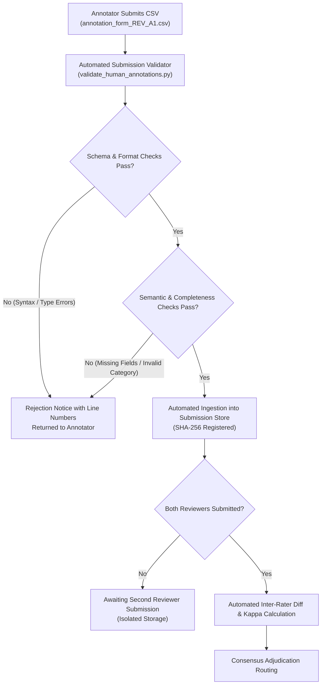

# PahaarPulse — Phase 2J: Reviewer Operations Plan & Quality Protocol

**Document Version:** v1.0  
**Effective Date:** 2026-10-23  
**Project:** PahaarPulse AI/ML Landslide Risk Management System  
**Authority:** Geotechnical Data-Quality Specialist & Evaluation Working Group  
**Status:** PILOT WORKFLOW READY (Human Reviews Pending; Benchmark Inference Strictly Blocked)

---

## 1. Executive Summary & Operational Scope

This document specifies the operational guidelines, personnel qualification standards, blinded evaluation procedures, submission ingestion mechanisms, and adjudication protocols for human expert review of the PahaarPulse ground-level photograph dataset.

The objective of this operational plan is to ensure that when qualified human geotechnical reviewers are onboarded:
1. Their evaluations are conducted independently and rigorously according to standardized geomorphic definitions.
2. Reviewers are fully blinded to AI model predictions, web discovery metadata, and companion reviewer responses.
3. Submissions are mechanically validated against strict syntactic and semantic schema invariants prior to acceptance.
4. Ambiguities and inter-rater disagreements are systematically surfaced and routed to senior geotechnical adjudication.
5. Zero synthetic or fabricated reviewer data enters the ground-truth benchmark.

> [!IMPORTANT]
> **Current Operational Baseline (Phase 2J):**  
> - **Total Cleared Images:** 102 candidate images indexed under opaque identifiers `ANN_001` through `ANN_102`.  
> - **Completed Human Reviews:** **0** (zero).  
> - **Completed Adjudications:** **0** (zero).  
> - **Fabricated Reviewers / Credentials:** **0** (strictly prohibited).  
> - **Downstream Model Inference:** **STRICTLY BLOCKED** until dual-blind review and adjudication are finalized.

---

## 2. Reviewer Qualification Framework

To establish a defensible, publication-grade benchmark for life-critical mountain hazard screening, human annotators must possess formal training and demonstrated competency in engineering geology, geomorphology, or geotechnical slope engineering.

### 2.1 Minimum Credential Requirements
Prospective reviewers must satisfy at least one of the following criteria:

| Profile Tier | Academic / Professional Qualification | Relevant Domain Experience |
| :--- | :--- | :--- |
| **Tier 1: Senior Geotechnical Expert** | Ph.D. or M.Sc. / M.Tech in Geotechnical Engineering, Engineering Geology, Geological Sciences, or Natural Hazard Mitigation | $\ge 5$ years practical or academic experience in rock slope stability, slope risk hazard mapping, or mountain transportation corridor geotechnical monitoring. |
| **Tier 2: Field Geotechnical Reviewer** | B.Sc. / B.Tech in Civil Engineering, Geology, Earth Sciences, or Geotechnical Engineering | $\ge 2$ years professional experience in slope inspection, rockfall netting / retaining wall design, or geohazard reconnaissance. |
| **Tier 3: Post-Graduate Geomorphology Researcher** | Enrolled Ph.D. candidate or advanced Master's researcher specializing in mass wasting, landslide kinematics, or fluvial/debris processes | Completed graduate coursework in rock mechanics, slope stability analysis, and remote sensing / field reconnaissance. |

### 2.2 Core Competency Verification
Prior to receiving the blinded annotation package, candidates must demonstrate:
1. **Kinematic Failure Mode Understanding:** Differentiation between planar rockslide, wedge sliding, toppling, rotational slump, debris flow, and shallow translational soil slip (Cruden & Varnes / Hungr classifications).
2. **Precursor Recognition:** Understanding and identification of tension cracks, en-echelon shear fractures, bulging retaining structures, road shoulder subsidence, and seepage discharge.
3. **Engineered Control Evaluation:** Visual familiarity with intact geotechnical mitigations (gabion/masonry/concrete retaining walls, pinned rockfall mesh, catch fences, lined drainage channels, culverts) and distinguishing functional mitigations from failed structures.
4. **Epistemic Honesty:** Explicit willingness to label occluded, low-contrast, or ambiguous scenes as `UNCERTAIN_INSUFFICIENT_CONTEXT` rather than speculating.

---

## 3. Reviewer Onboarding, Blinded Intake & Credential Custody

### 3.1 Blinded Reviewer Anonymization
To avoid bias, halo effects, and ad-hominem dispute during adjudication:
- Each reviewer is assigned an opaque alphanumeric identifier:
  - Primary Annotator 1: `REV_A1`
  - Primary Annotator 2: `REV_B2`
  - Senior Adjudicator: `ADJ_LEAD`
- Real names, institutional affiliations, CVs, and contact information are recorded in a secure, offline administrative credential registry that is strictly separated from the annotation repository and benchmark manifests.

### 3.2 Formal Affirmation & Ethical Commitments
Every reviewer must sign an electronic affirmation covering the following invariants:
1. **Strict Reviewer Independence:** Reviewers must not communicate, consult, or share observations with one another until the adjudication phase is officially opened by the Adjudication Lead.
2. **Prohibition of External Web Search:** Reviewers are strictly forbidden from performing reverse image searches (e.g., Google Lens, TinEye, Bing Visual Search) or searching filenames to identify image source contexts. All classifications must be grounded solely in the optical evidence of the provided raster.
3. **Native Resolution Inspection:** Reviewers must inspect images on calibrated displays ($\ge 1080\text{p}$) at $100\%$ uncompressed scale to observe fine tension cracking and rockfall fragments.
4. **No Model Contamination:** Reviewers must affirm they have had no access to Gemma VLM zero-shot predictions or historical prompt transcripts.

---

## 4. Blinded Batch Distribution & Data Isolation

### 4.1 Blinded Package Contents
Reviewers receive a standardized distribution bundle containing:
1. `candidate_index_blinded.csv`: Contains only `annotation_id` (`ANN_001` to `ANN_102`) and the opaque local image filename. Excludes original URLs, discovery queries, license tags, and geographic coordinates.
2. `images/`: High-resolution JPEG/PNG files renamed to opaque names (`ANN_001.jpg` to `ANN_102.jpg`) or accessed via immutable paths.
3. `annotation_protocol.md`: The authoritative taxonomy specification.
4. `annotator_instructions.md`: Step-by-step 4-zone inspection instructions.
5. `reviewer_checklist.md`: Pre-review and per-image quality control checklists.
6. `annotation_form_<REVIEWER_ID>.csv`: Personal pre-formatted template with 102 rows, with all review fields set to `PENDING`.

### 4.2 Data Isolation Boundaries
- Reviewers have **zero access** to production database environments, production API endpoints, or production upload storage (`backend/uploads/`).
- Annotation packages are distributed via isolated repository subdirectories or secure file transfer.

---

## 5. Submission Ingestion & Automated Validation Pipeline

When an annotator completes their review, the submission undergoes automated ingestion and mechanical validation before being registered into the audit trail.

### 5.1 Validation Checkpoints
The validation engine (`backend/scripts/validate_human_annotations.py`) enforces:
1. **Schema Integrity:** Exact header column match with zero missing or extraneous columns.
2. **Identifier Validity:** Every `annotation_id` exists in `candidate_index.csv` (`ANN_001`–`ANN_102`).
3. **Taxonomy Enforcement:** `primary_category` must strictly match one of the 6 canonical categories:
   - `ACUTE_SLOPE_FAILURE_OR_DEBRIS`
   - `PRECURSOR_INSTABILITY_INDICATOR`
   - `INTACT_ENGINEERING_CONTROL`
   - `CONTEXTUAL_TERRAIN_LANDSCAPE`
   - `UNCERTAIN_INSUFFICIENT_CONTEXT`
   - `UNUSABLE_OUT_OF_SCOPE`
4. **Confidence Rating:** Must be exactly `HIGH`, `MEDIUM`, or `LOW`.
5. **Quality Limitations:** Must be valid tokens from `{'NONE', 'BLURRED', 'DISTANT', 'LOW_CONTRAST', 'OCCLUDED'}`.
6. **Rationale Completeness:** `geomorphic_rationale` must be non-empty and explain the visual evidence.
7. **Timestamp Compliance:** Valid ISO 8601 UTC timestamp format (`YYYY-MM-DDTHH:MM:SSZ`).
8. **Duplicate Detection:** Rejection of duplicate evaluations for the same image by the same reviewer.

---

## 6. Adjudication Escalation & Inter-Rater Reliability Protocol

### 6.1 Automated Disagreement Detection
Once submissions from both `REV_A1` and `REV_B2` pass validation, the system automatically compares classifications for each `annotation_id`.

A case is flagged for formal adjudication if **any** of the following conditions occur:
1. **Primary Category Mismatch:** `REV_A1.primary_category != REV_B2.primary_category`.
2. **Reviewer Escalation Request:** Either reviewer set `requires_adjudication = YES`.
3. **Uncertainty Flagged:** Either reviewer selected `UNCERTAIN_INSUFFICIENT_CONTEXT` or `UNUSABLE_OUT_OF_SCOPE`.
4. **Significant Confidence Discrepancy:** One reviewer selected `HIGH` while the other selected `LOW`.

### 6.2 Inter-Rater Reliability Thresholds
Before adjudication resolutions are finalized, statistical agreement metrics are calculated:
- **Observed Proportion of Agreement ($P_o$):** Across all 6 categories.
- **Cohen's Kappa ($\kappa$):** Computed across binary hazard detection:
  - Class $H$ (Hazard / Precursor): `ACUTE_SLOPE_FAILURE_OR_DEBRIS` $\cup$ `PRECURSOR_INSTABILITY_INDICATOR`
  - Class $N$ (Non-Hazard / Control): `INTACT_ENGINEERING_CONTROL` $\cup$ `CONTEXTUAL_TERRAIN_LANDSCAPE`
- **Acceptance Gate:** Target inter-rater agreement threshold is $\kappa \ge 0.70$. If $\kappa < 0.70$, an annotator calibration session is convened to clarify taxonomy boundaries before re-evaluating discordant items.

### 6.3 Adjudication Decision Rules
The Senior Geotechnical Adjudicator (`ADJ_LEAD`):
1. Opens both blinded reviews side-by-side with full 100% resolution image view.
2. Reviews the physical rationale provided by each reviewer.
3. Renders the authoritative `adjudicated_category` and records a detailed `adjudication_rationale`.
4. Sets `consensus_status` to:
   - `AGREED_CONSENSUS`: Both reviewers originally agreed.
   - `ADJUDICATED_RESOLVED`: Disagreement resolved by authoritative expert adjudication.
   - `FLAGGED_DISPUTED_INSUFFICIENT_CONTEXT`: Irresolvable due to optical ambiguity; retained as uncertain control or excluded from safety-critical benchmark slices.

---

## 7. Pilot Annotation Batch Specification ($N=10$)

To operationalize and calibrate this workflow prior to full 102-image evaluation, a representative pilot batch of $N=10$ candidate images has been selected across diverse hazard types, geographic regions, and engineered conditions.

### 7.1 Pilot Image Composition

| Pilot ID | Annotation ID | Candidate ID | Site / Event Group | Target Geomorphic Type | Rationale for Pilot Inclusion |
| :---: | :---: | :---: | :---: | :---: | :---: |
| `PILOT_01` | `ANN_065` | `WMC_37943355` | Himachal Rohtang Pass Rock Clearing | Acute Rockfall / Debris on Road | Heavy machinery clearing fallen boulders from high-altitude Himalayan highway. Tests acute road-blocking hazard detection. |
| `PILOT_02` | `ANN_047` | `WMC_175414035` | Kinnaur Nigulsari Slide Sector | Acute Rockslide / Crown Scarp | Massive active slope detachment in Kinnaur corridor. Tests detection of major crown scarps and rock fall mass. |
| `PILOT_03` | `ANN_040` | `WMC_14428956` | Conwy Mountain Road Sector | Precursor Asphalt Tension Cracks | Pronounced longitudinal and arcuate fractures in road pavement without catastrophic collapse. Tests subtle early warning. |
| `PILOT_04` | `ANN_041` | `WMC_148232762` | Rainbow Park Road Sector | Precursor Subsidence / Culvert Damage | Road shoulder deformation and cracking adjacent to drainage culvert. Tests infrastructure sub-failure distress detection. |
| `PILOT_05` | `ANN_068` | `WMC_43490410` | Davis Mountains Sector | Intact Retaining Wall (Negative Control) | Sound, well-maintained masonry retaining wall supporting mountain highway cut slope. Negative control against false alarms. |
| `PILOT_06` | `ANN_018` | `WMC_124870041` | Zanskar Kargyak Road Culvert | Intact Drainage Culvert (Negative Control) | Operational roadside box culvert and ditch channeling mountain runoff. Tests drainage feature recognition. |
| `PILOT_07` | `ANN_028` | `WMC_133509156` | ODOT Rockfall Mesh Series | Intact Pinned Netting (Negative Control) | Engineered wire drapery netting installed across steep rock cut slope. Tests differentiation between engineered mesh and rockfall. |
| `PILOT_08` | `ANN_093` | `WMC_89089252` | Colorado Cumberland Pass | Contextual Mountain Pass Landscape | Panoramic mountain pass with stable unpaved road and undisturbed alpine terrain. Negative control for regional context. |
| `PILOT_09` | `ANN_050` | `WMC_179395944` | Tharali Chamoli Debris Sector | Ambiguous / High-Altitude Debris Slide | High-altitude debris scarp with mixed lighting and distance. Tests reviewer uncertainty calibration and boundary criteria. |
| `PILOT_10` | `ANN_014` | `WMC_123141626` | Himachal Mandi-Kullu Highway Cut Sector | Distant Highway Cut Slope | Roadside cut slope photographed from vehicle perspective with partial roadside features. Tests perspective distance handling. |

All 10 pilot records are indexed in `docs/gemma-local-vision/evaluation/PHASE_2J_PILOT_SELECTION.csv` with `review_status = PENDING`.

---

## 8. Summary of Operational Status

- **Validator Implementation:** `backend/scripts/validate_human_annotations.py` implemented with CLI and programmatic interfaces.
- **Pilot Dataset Package:** `docs/gemma-local-vision/evaluation/PHASE_2J_PILOT_SELECTION.csv` prepared with 10 unpopulated pending rows.
- **Test Suite:** All validation rules, error modes, and dry-run safety verified in `backend/tests/test_phase_2j_submission_validation.py`.
- **Database & Production Isolation:** Zero mutations to production database tables or `backend/uploads/`.
- **Benchmark Gate:** Benchmark model inference remains strictly **BLOCKED** until pilot review, calibration, full annotations, and adjudication are finalized.
