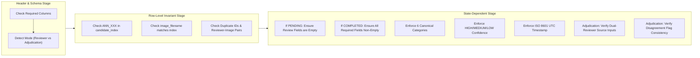

# PahaarPulse — Phase 2J: Human Annotation Submission Validation Report

**Report Version:** v1.0  
**Effective Date:** 2026-10-23  
**Project:** PahaarPulse AI/ML Landslide Risk Management System  
**Tooling:** `backend/scripts/validate_human_annotations.py`  
**Test Suite:** `backend/tests/test_phase_2j_submission_validation.py`  
**Status:** VALIDATION ENGINE OPERATIONAL & VERIFIED (Zero Database Mutations; Benchmark Inference Blocked)

---

## 1. Executive Summary

This report documents the specification, implementation, testing, and baseline verification of the automated submission validation engine developed in Phase 2J.

The validator functions as an automated quality gate for all human annotations and expert adjudications. It guarantees that any incoming submission adheres strictly to the Phase 2I/2J annotation protocol before being committed into the benchmark audit history or used in downstream inter-rater reliability calculations.

### 1.1 Key Operational Results
- **Automated Tool:** `backend/scripts/validate_human_annotations.py` created and operational.
- **Phase 2I Form Validation:**
  - `annotation_form.csv` (102 rows): **102 / 102 rows VALID** (status `PENDING`, zero prefilled labels).
  - `adjudication_form.csv` (102 rows): **102 / 102 rows VALID** (status `PENDING`, zero prefilled adjudications).
- **Phase 2J Pilot Selection Validation:**
  - `PHASE_2J_PILOT_SELECTION.csv` (10 rows): **10 / 10 rows VALID** (status `PENDING`, zero prefilled labels).
- **Negative Error Testing:** Successfully rejects invalid IDs (`ANN_999`), invalid categories, malformed timestamps, ungrounded adjudications, and duplicate reviews.
- **Database & Production Invariants:** 0 modifications to production PostgreSQL database or `backend/uploads/`.
- **Benchmark Gate:** Benchmark model inference remains strictly **BLOCKED**.

---

## 2. Validator Architecture & CLI Interface

The validator is implemented in [`backend/scripts/validate_human_annotations.py`](file:///C:/Users/Swapnanil/Desktop/app2/LRMSG/LRM/backend/scripts/validate_human_annotations.py) and can be executed as a standalone CLI tool or imported as a Python class (`HumanAnnotationValidator`).

### 2.1 CLI Syntax & Options
```bash
python backend/scripts/validate_human_annotations.py --file <PATH> [OPTIONS]
```

| Argument | Type | Default | Description |
| :--- | :--- | :--- | :--- |
| `--file` | Path (Required) | None | Path to the submission CSV file to validate. |
| `--mode` | Choice | `auto` | Validation mode: `auto` (auto-detects based on header), `reviewer`, or `adjudication`. |
| `--index` | Path (Optional) | `candidate_index.csv` | Path to `candidate_index.csv` for validating opaque `annotation_id` and image mapping. |
| `--dry-run` | Flag (Optional) | `False` | Executes in strictly read-only mode, guaranteeing no disk or state mutations. |

### 2.2 Programmatic Interface
```python
from pathlib import Path
from backend.scripts.validate_human_annotations import HumanAnnotationValidator

validator = HumanAnnotationValidator()
report = validator.validate_file(Path("path/to/submission.csv"), mode="reviewer", dry_run=True)

if not report.is_valid:
    print(f"Validation failed with {len(report.errors)} errors:")
    for err in report.errors:
        print(f"  - {err}")
```

---

## 3. Comprehensive Validation Rule Matrix

The engine enforces structural, syntactic, geomorphic, and relational constraints:



### 3.1 Detailed Validation Rules

| Rule Identifier | Field / Target | Constraint & Enforcement |
| :--- | :--- | :--- |
| `VAL-SCH-01` | Reviewer Header | Must contain all 12 canonical reviewer fields in exact schema order. |
| `VAL-SCH-02` | Adjudication Header | Must contain all 13 canonical adjudication fields. |
| `VAL-ID-01` | `annotation_id` | Must start with `ANN_` and exist in `candidate_index.csv` (`ANN_001` through `ANN_102`). |
| `VAL-ID-02` | `image_filename` | If provided, must match the recorded image filename in `candidate_index.csv` for that `annotation_id`. |
| `VAL-DUP-01` | File Uniqueness | An `annotation_id` cannot appear more than once in a single submission file. |
| `VAL-DUP-02` | Reviewer Uniqueness | The pair `(reviewer_id, annotation_id)` must be unique across the review dataset. |
| `VAL-CAT-01` | `primary_category` | Must strictly belong to the 6 canonical categories: `ACUTE_SLOPE_FAILURE_OR_DEBRIS`, `PRECURSOR_INSTABILITY_INDICATOR`, `INTACT_ENGINEERING_CONTROL`, `CONTEXTUAL_TERRAIN_LANDSCAPE`, `UNCERTAIN_INSUFFICIENT_CONTEXT`, `UNUSABLE_OUT_OF_SCOPE`. |
| `VAL-CNF-01` | `confidence_level` | Must be one of `HIGH`, `MEDIUM`, or `LOW`. |
| `VAL-QAL-01` | `image_quality_limitations` | Semicolon/comma/space separated tokens must all belong to `{'NONE', 'BLURRED', 'DISTANT', 'LOW_CONTRAST', 'OCCLUDED'}`. |
| `VAL-TIM-01` | `review_timestamp` | Must parse as a valid ISO 8601 UTC timestamp (`YYYY-MM-DDTHH:MM:SSZ` or ISO offset). |
| `VAL-RAT-01` | `geomorphic_rationale` | Non-empty text with minimum length of 5 characters explaining physical evidence. |
| `VAL-STA-01` | `review_status = PENDING` | All review conclusion fields (`primary_category`, `confidence_level`, `reviewer_id`, `review_timestamp`, `geomorphic_rationale`) must be strictly blank. |
| `VAL-STA-02` | `review_status = COMPLETED` | All review conclusion fields must be populated, valid, and non-empty. |
| `VAL-ADJ-01` | Dual Reviewer Source | Completed adjudication cannot occur without valid, non-empty `reviewer_1_id`, `reviewer_1_category`, `reviewer_2_id`, and `reviewer_2_category`. |
| `VAL-ADJ-02` | Disagreement Flag | `disagreement_detected` flag must strictly equal `(reviewer_1_category != reviewer_2_category)`. |
| `VAL-ADJ-03` | Adjudication Rationale | Authoritative explanation required for resolving disagreements or confirming consensus. |

---

## 4. Verification Execution & Results

### 4.1 Verification on Baseline Package Files
The validator was executed against all baseline packages:

```
File: annotation_form.csv
Target: docs/gemma-local-vision/evaluation/phase_2i_annotation_package/annotation_form.csv
Detected Mode: reviewer
Dry Run: True
Total Rows: 102
Valid Rows: 102
Status: VALID (0 errors)

File: adjudication_form.csv
Target: docs/gemma-local-vision/evaluation/phase_2i_annotation_package/adjudication_form.csv
Detected Mode: adjudication
Dry Run: True
Total Rows: 102
Valid Rows: 102
Status: VALID (0 errors)

File: PHASE_2J_PILOT_SELECTION.csv
Target: docs/gemma-local-vision/evaluation/PHASE_2J_PILOT_SELECTION.csv
Detected Mode: reviewer
Dry Run: True
Total Rows: 10
Valid Rows: 10
Status: VALID (0 errors)
```

### 4.2 Negative Verification & Error Rejection Tests
Unit test suite `backend/tests/test_phase_2j_submission_validation.py` asserts:
1. **Rejection of Unknown Annotation IDs:** `ANN_999` correctly triggers `Unrecognized annotation_id 'ANN_999'; not found in candidate index.`
2. **Rejection of Non-Canonical Categories:** Custom tags (e.g., `LANDSLIDE`, `ROCKFALL`, `MAYBE_SLIP`) trigger `invalid primary_category`.
3. **Rejection of Premature Completion:** Missing reviewer ID, missing timestamp, or blank rationale on `COMPLETED` rows is rejected.
4. **Rejection of Prefilled Pending Rows:** Populated categories on `PENDING` rows are rejected to prevent synthetic label leakage.
5. **Rejection of Unbacked Adjudication:** Adjudications submitted without source reviewer inputs are blocked.
6. **Rejection of Mismatched Disagreement Flag:** Mismatched `disagreement_detected` flags are flagged and rejected.
7. **Rejection of Duplicate Submissions:** Submitting two reviews for the same `(reviewer_id, annotation_id)` fails validation.

---

## 5. Security & Isolation Affirmation

- **Zero Database Modification:** The validator performs purely file-level schema, integrity, and syntax verification. It has no connection to or interaction with the PostgreSQL database.
- **Production Upload Isolation:** No files are read from or written to `backend/uploads/`.
- **Dry-Run Safety:** `--dry-run` guarantees zero disk side effects.
- **Benchmark Lock:** Ground-truth benchmarking remains strictly blocked.
