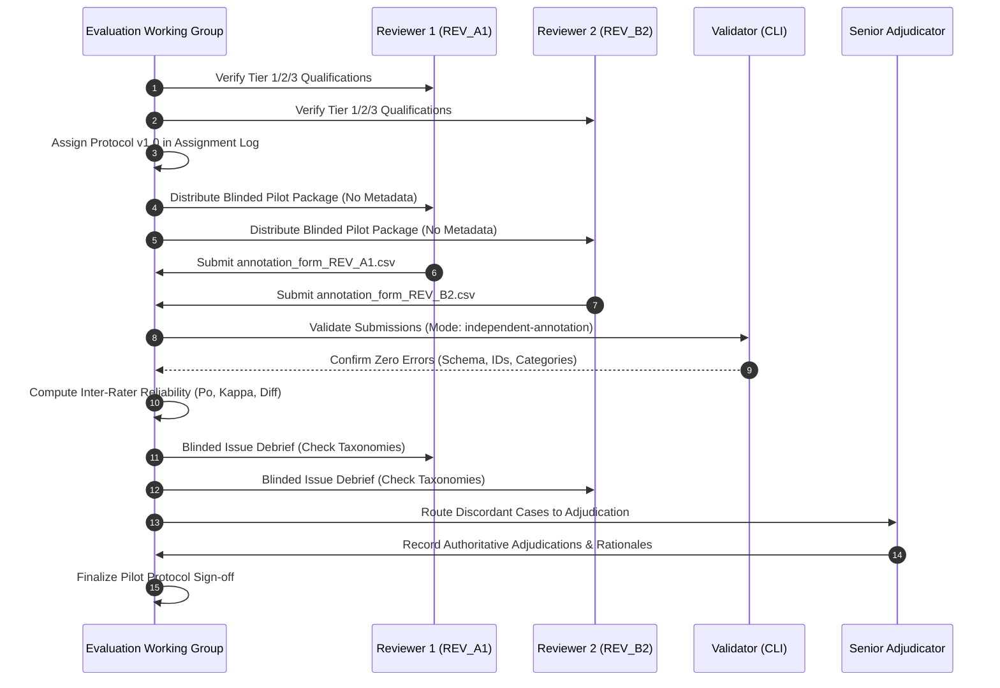
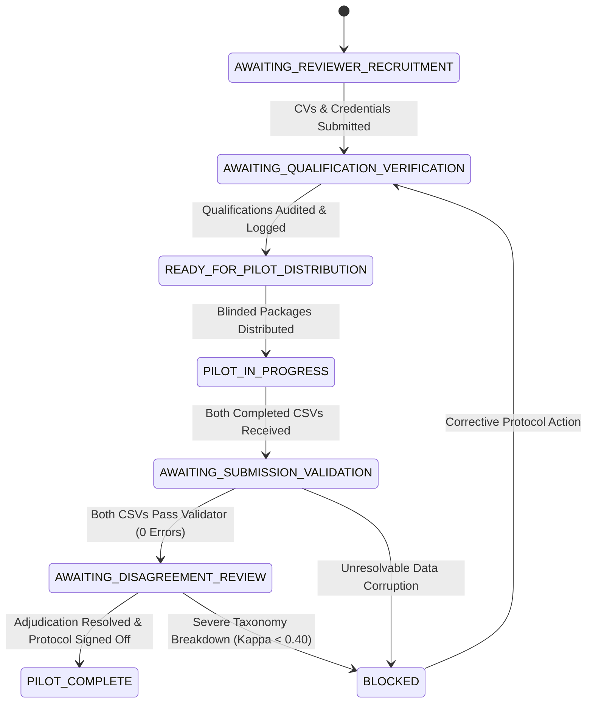

# PahaarPulse — Phase 2K: 10-Image Pilot Execution Plan, Operational Gates & Reliability Protocol

**Document Version:** v1.0  
**Effective Date:** 2026-10-23  
**Project:** PahaarPulse AI/ML Landslide Risk Management System  
**Authority:** Geotechnical Data-Quality Specialist & Evaluation Working Group  
**Status:** OPERATIONAL PLAN APPROVED (Awaiting Reviewer Recruitment & Qualification)

---

## 1. Executive Summary & Objective

This document defines the end-to-end execution controls, state-based operational gates, and statistical reliability methodology for launching the 10-image Phase 2J pilot evaluation.

The pilot is intended exclusively as a **methodology and taxonomy validation instrument**. Its objective is to test whether the 6-class geomorphic taxonomy, blinded package distribution, independent review workflow, and adjudication mechanisms operate without friction before launching the full 102-image evaluation.

> [!IMPORTANT]
> **Strict Non-Performance Scope:**  
> The 10-image pilot does **not** evaluate the Gemma VLM, nor does it generate statistical claims regarding model accuracy or recall. No model inference will be executed against this pilot. Benchmark model inference remains strictly **BLOCKED**.

---

## 2. Pilot Dataset Selection & Dependency Analysis

The pilot utilizes the 10 representative candidates established in [`PHASE_2J_PILOT_SELECTION.csv`](file:///C:/Users/Swapnanil/Desktop/app2/LRMSG/LRM/docs/gemma-local-vision/evaluation/PHASE_2J_PILOT_SELECTION.csv).

### 2.1 Candidate Composition & Geomorphic Variety

| Pilot ID | Annotation ID | Candidate ID | Site / Event Cluster Group | Target Hazard / Control Category | Geotechnical Function in Pilot |
| :---: | :---: | :---: | :--- | :--- | :--- |
| `PILOT_01` | `ANN_065` | `WMC_37943355` | `Himachal_Rohtang_Pass_Clearing` | `ACUTE_SLOPE_FAILURE_OR_DEBRIS` | Active rockfall blocking highway lane with heavy machinery clearing rubble. |
| `PILOT_02` | `ANN_047` | `WMC_175414035` | `Regional_Site_WMC_175414035` | `ACUTE_SLOPE_FAILURE_OR_DEBRIS` | Massive Kinnaur corridor detachment scarp and rockslide mass. |
| `PILOT_03` | `ANN_040` | `WMC_14428956` | `GPS_53.336810__-3.877200` | `PRECURSOR_INSTABILITY_INDICATOR` | Longitudinal and arcuate asphalt tension cracking across roadway. |
| `PILOT_04` | `ANN_041` | `WMC_148232762` | `UNKNOWN_SITE_EVENT_WMC_148232762` | `PRECURSOR_INSTABILITY_INDICATOR` | Road shoulder subsidence and culvert distress without full slope collapse. |
| `PILOT_05` | `ANN_068` | `WMC_43490410` | `GPS_30.598500__-103.917100` | `INTACT_ENGINEERING_CONTROL` | Intact stone masonry retaining wall supporting mountain cut slope (negative control). |
| `PILOT_06` | `ANN_018` | `WMC_124870041` | `Regional_Site_WMC_124870041` | `INTACT_ENGINEERING_CONTROL` | Clean roadside box culvert and masonry ditch channeling water (negative control). |
| `PILOT_07` | `ANN_028` | `WMC_133509156` | `ODOT_Helicopter_Rockfall_Mesh_Series` | `INTACT_ENGINEERING_CONTROL` | Pinned wire mesh drape safely holding rock face fragments (negative control). |
| `PILOT_08` | `ANN_093` | `WMC_89089252` | `Colorado_Cumberland_Pass` | `CONTEXTUAL_TERRAIN_LANDSCAPE` | High-altitude mountain pass road with undisturbed stable terrain (regional context). |
| `PILOT_09` | `ANN_050` | `WMC_179395944` | `Regional_Site_WMC_179395944` | `UNCERTAIN_INSUFFICIENT_CONTEXT` | Complex high-altitude debris scene; tests reviewer boundary calibration. |
| `PILOT_10` | `ANN_014` | `WMC_123141626` | `Himachal_Mandi_Kullu_Highway_370_371` | `CONTEXTUAL_TERRAIN_LANDSCAPE` | Distant road cut perspective; tests optical distance and resolution handling. |

### 2.2 Site / Event Independence & Cross-Batch Audit
- **Site Independence:** Every one of the 10 pilot images belongs to a distinct site/event cluster (10 distinct groups). There is zero multi-image clustering or co-dependence within the pilot.
- **Physical Hash Deduplication:** All 10 images correspond to 10 unique SHA-256 hashes.
- **Cross-Batch Duplicates:** In the broader repository, `ANN_065` (`WMC_37943355`) and `ANN_040` (`WMC_14428956`) had identical duplicate files across batch folders. The pilot uses the single canonical deduped copy from `candidate_index.csv`.
- **Precursor and Control Balance:** The cohort contains 2 acute failures, 2 early precursors, 3 intact engineering controls, 2 contextual landscapes, and 1 ambiguous high-altitude case.

---

## 3. Strict Nine-Step Pilot Execution Sequence

### Detailed Sequence:
1. **Step 1 — Qualification Verification:** Evaluate academic degrees and domain CVs against Tier 1, 2, or 3 standards. Log verified verifier sign-offs in [`reviewer_qualification_log_template.csv`](file:///C:/Users/Swapnanil/Desktop/app2/LRMSG/LRM/docs/gemma-local-vision/evaluation/phase_2k_reviewer_onboarding/reviewer_qualification_log_template.csv).
2. **Step 2 — Protocol Version Lock:** Assign identical protocol version `v1.0` and log entries in [`reviewer_assignment_template.csv`](file:///C:/Users/Swapnanil/Desktop/app2/LRMSG/LRM/docs/gemma-local-vision/evaluation/phase_2k_reviewer_onboarding/reviewer_assignment_template.csv).
3. **Step 3 — Blinded Distribution:** Transmit the 10 uncompressed native image rasters and blinded annotation template to Reviewers 1 and 2 independently.
4. **Step 4 — Independent Review:** Reviewers evaluate images under 4-zone inspection rules without consulting one another or conducting web searches.
5. **Step 5 — Automated Submission Validation:** Execute `backend/scripts/validate_human_annotations.py --mode independent-annotation --file <PATH> --require-completed`. Both files must achieve `Status: VALID` with zero errors.
6. **Step 6 — Inter-Rater Reliability Calculation:** Calculate raw percent agreement $P_o$, Cohen's Kappa $\kappa$, and generate category confusion cross-tabs.
7. **Step 7 — Blinded Protocol Review:** Reviewers record taxonomy friction, resolution limits, or edge-case uncertainties in [`pilot_issue_log_template.csv`](file:///C:/Users/Swapnanil/Desktop/app2/LRMSG/LRM/docs/gemma-local-vision/evaluation/phase_2k_reviewer_onboarding/pilot_issue_log_template.csv) without revealing individual answers to each other.
8. **Step 8 — Expert Adjudication:** Senior Geotechnical Adjudicator reviews discordant cases at 100% native resolution, enters authoritative consensus categories, and writes geotechnical rationales into `adjudication_form.csv`.
9. **Step 9 — Protocol Sign-off:** The Working Group approves Protocol `v1.0` for full 102-image rollout, or issues minor taxonomy amendments (`v1.1`) if systematic confusion was uncovered.

---

## 4. Evidence-Based Operational Gates

The evaluation pipeline transitions through discrete operational states based strictly on verified documentary evidence:

### Gate Transition Criteria:

| Operational State | Current Status | Entry Condition / Required Evidence | Permissible Next Transition |
| :--- | :---: | :--- | :--- |
| `AWAITING_REVIEWER_RECRUITMENT` | **ACTIVE** | Initial baseline state. Onboarding packet and validator ready. | Transition to `AWAITING_QUALIFICATION_VERIFICATION` upon receipt of candidate applications. |
| `AWAITING_QUALIFICATION_VERIFICATION` | Inactive | Candidate credentials received. | Transition to `READY_FOR_PILOT_DISTRIBUTION` only when degree audits and CV checks are signed off by Evaluation Lead. |
| `READY_FOR_PILOT_DISTRIBUTION` | Inactive | 2 verified reviewers logged in `reviewer_qualification_log.csv` and assigned in `reviewer_assignment.csv`. | Transition to `PILOT_IN_PROGRESS` upon package dispatch. |
| `PILOT_IN_PROGRESS` | Inactive | Packages confirmed received; reviewers independently annotating. | Transition to `AWAITING_SUBMISSION_VALIDATION` upon receipt of both completed CSVs. |
| `AWAITING_SUBMISSION_VALIDATION` | Inactive | Both completed CSVs submitted. | Transition to `AWAITING_DISAGREEMENT_REVIEW` only if both files pass `validate_human_annotations.py` with 0 errors. |
| `AWAITING_DISAGREEMENT_REVIEW` | Inactive | Submissions validated; inter-rater agreement calculated. | Transition to `PILOT_COMPLETE` upon adjudication of all discordant cases. |
| `PILOT_COMPLETE` | Inactive | Pilot consensus locked; protocol approved for 102-image cohort. | Transition to full dataset annotation rollout. |
| `BLOCKED` | Inactive | Severe schema failure, reviewer breach of blinding, or extreme taxonomy ambiguity. | Requires Working Group intervention and protocol amendment. |

---

## 5. Reliability & Adjudication Methodology

### 5.1 Categorical Fields Included in Agreement Calculation
Inter-rater agreement is evaluated across three complementary levels:
1. **6-Class Multi-Category Agreement:** Direct comparison across all 6 canonical categories.
2. **Binary Hazard Detection Agreement:** Collapsed comparison between Hazard (`ACUTE_SLOPE_FAILURE_OR_DEBRIS` $\cup$ `PRECURSOR_INSTABILITY_INDICATOR`) versus Non-Hazard Control (`INTACT_ENGINEERING_CONTROL` $\cup$ `CONTEXTUAL_TERRAIN_LANDSCAPE`).
3. **Escalation Flag Agreement:** Agreement on `requires_adjudication` (`YES` vs. `NO`).

### 5.2 Handling Missing, Uncertain, and Unusable Responses
- **Missing Data:** Submissions with missing fields fail mechanical validation and are rejected immediately.
- **Uncertain Category (`UNCERTAIN_INSUFFICIENT_CONTEXT`):** Treated as a legitimate geomorphic classification, not an error. Agreement on uncertainty indicates shared recognition of visual limitations.
- **Unusable Category (`UNUSABLE_OUT_OF_SCOPE`):** Any image assigned this category is automatically flagged for Senior Adjudication to verify whether raster defects warrant exclusion.

### 5.3 Reliability Metrics & The Kappa Paradox
- **Observed Percent Agreement ($P_o$):**  
  $$P_o = \frac{\sum_{i=1}^{k} n_{ii}}{N}$$
- **Cohen's Kappa ($\kappa$):**  
  $$\kappa = \frac{P_o - P_e}{1 - P_e}$$  
  where $P_e$ is the expected chance agreement.
- **Class Imbalance & Alternative Metrics:**  
  In small pilot datasets or unbalanced subsets (e.g., predominantly intact controls or rare precursors), high observed agreement can yield an artificially low Kappa (the *Kappa paradox*). To prevent misinterpretation, the system computes:
  1. Unadjusted Cohen's Kappa ($\kappa$).
  2. Prevalence-Adjusted Bias-Adjusted Kappa (PABAK).
  3. Gwet's $AC_1$ statistic, which is stable under severe marginal imbalance.

### 5.4 Adjudication Thresholds & Contingency Protocol
- **Target Threshold:** Binary hazard detection target is $\kappa \ge 0.70$ (substantial agreement).
- **Contingency if $\kappa < 0.70$:**
  1. Convene a blinded debrief with both reviewers to inspect discordant cases.
  2. Identify whether disagreement stems from terminology confusion (e.g., confusing loose unpaved road gravel with fresh rockfall).
  3. Amend [`annotation_protocol.md`](file:///C:/Users/Swapnanil/Desktop/app2/LRMSG/LRM/docs/gemma-local-vision/evaluation/phase_2i_annotation_package/annotation_protocol.md) to Version `v1.1` with explicit visual exemplars.
  4. Conduct a second 10-image calibration round on alternate candidates before clearing the full 102-image evaluation.

> [!CAUTION]
> **No Premature Reliability Scoring:**  
> In accordance with scientific integrity guidelines, no reliability coefficient or kappa score will be reported until real independent human evaluations are submitted.
