# PahaarPulse — Phase 2L: Workflow State Machine & Operational Control Gates

**Document Version:** v1.0  
**Effective Date:** 2026-10-23  
**Project:** PahaarPulse AI/ML Landslide Risk Management System  
**Authority:** Geotechnical Data-Quality Specialist & Evaluation Working Group  
**Status:** SPECIFICATION VERIFIED VIA SYNTHETIC DRY RUN

---

## 1. Overview & Architectural Philosophy

The PahaarPulse human evaluation pipeline is governed by a deterministic, evidence-based finite state machine. To guarantee scientific defensibility:
- No state transition may occur without verifiable cryptographic or programmatic evidence (e.g., validated CSV hashes, signed qualification records).
- Reviewer blinding and data isolation are enforced at the transition boundaries.
- Adjudication can only be entered when two distinct, complete, and validated independent submissions are present.
- Benchmark model inference remains locked in all states prior to authoritative consensus locking.

---

## 2. State Transition Diagram

```mermaid
stateDiagram-v2
    [*] --> AWAITING_REVIEWER_RECRUITMENT
    
    AWAITING_REVIEWER_RECRUITMENT --> AWAITING_QUALIFICATION_VERIFICATION: Event: CVs & Credentials Received
    
    AWAITING_QUALIFICATION_VERIFICATION --> READY_FOR_PILOT_DISTRIBUTION: Guard: Tier 1/2/3 Audited & Signed Off
    AWAITING_QUALIFICATION_VERIFICATION --> BLOCKED: Failure: Credential Verification Rejected
    
    READY_FOR_PILOT_DISTRIBUTION --> PILOT_IN_PROGRESS: Guard: Blinded Packages Dispatched; Assignment Logged
    
    PILOT_IN_PROGRESS --> AWAITING_SUBMISSION_VALIDATION: Event: Both Independent Submissions Received
    
    AWAITING_SUBMISSION_VALIDATION --> AWAITING_DISAGREEMENT_REVIEW: Guard: validate_human_annotations.py Passes (0 Errors)
    AWAITING_SUBMISSION_VALIDATION --> PILOT_IN_PROGRESS: Failure: Schema/Syntax Rejection (Returned to Reviewer)
    AWAITING_SUBMISSION_VALIDATION --> BLOCKED: Failure: Plagiarism / Unblinding Breach Detected
    
    AWAITING_DISAGREEMENT_REVIEW --> PILOT_COMPLETE: Guard: All Discordant Cases Adjudicated & Signed Off
    AWAITING_DISAGREEMENT_REVIEW --> BLOCKED: Failure: Severe Taxonomy Breakdown (Kappa < 0.40)
    
    BLOCKED --> AWAITING_QUALIFICATION_VERIFICATION: Action: Protocol Revision (v1.1) & Re-Calibration
    
    PILOT_COMPLETE --> [*]: Action: Proceed to Full 102-Cohort Rollout
```

---

## 3. Detailed State Invariants & Evidence Gates

### 3.1 State 1: `AWAITING_REVIEWER_RECRUITMENT`
- **Definition:** Baseline resting state. The candidate image collection is cleared (102 images), the pilot cohort is selected (10 images), and all package templates are staged with pending fields.
- **Entry Condition:** Completed dataset ingestion and license audit.
- **Invariants:** 0 human reviewers recruited, 0 annotations completed, 0 adjudications.
- **Exit Trigger:** Prospective candidates express interest and submit CVs/degrees.

### 3.2 State 2: `AWAITING_QUALIFICATION_VERIFICATION`
- **Definition:** Candidate credentials are under audit by the Evaluation Working Group.
- **Entry Condition:** Receipt of official academic degrees, professional licenses, and CVs.
- **Invariants:** Reviewers are assigned pseudonyms (`REV_A1`, `REV_B2`). Personal identifiers remain strictly isolated in offline records.
- **Guard Condition to Advance:**
  1. Both candidates verified against Tier 1, 2, or 3 qualification standards.
  2. All 4 core geotechnical competencies verified.
  3. Working Group Lead signs off in [`reviewer_qualification_log_template.csv`](file:///C:/Users/Swapnanil/Desktop/app2/LRMSG/LRM/docs/gemma-local-vision/evaluation/phase_2k_reviewer_onboarding/reviewer_qualification_log_template.csv).

### 3.3 State 3: `READY_FOR_PILOT_DISTRIBUTION`
- **Definition:** Reviewers are fully qualified and assigned, and blinded packages are ready for dispatch.
- **Entry Condition:** Approved qualification log and signed onboarding checklist.
- **Invariants:** Both reviewers assigned identical protocol version (`v1.0`).
- **Guard Condition to Advance:**
  1. Assignment records completed in [`reviewer_assignment_template.csv`](file:///C:/Users/Swapnanil/Desktop/app2/LRMSG/LRM/docs/gemma-local-vision/evaluation/phase_2k_reviewer_onboarding/reviewer_assignment_template.csv).
  2. Reviewers affirm independence and reverse-image search ban in writing.
  3. Distribution of blinded image rasters without metadata or search tags.

### 3.4 State 4: `PILOT_IN_PROGRESS`
- **Definition:** Reviewers are independently conducting 4-zone visual inspections.
- **Entry Condition:** Confirmation of blinded package receipt by both reviewers.
- **Invariants:** Zero communication between Reviewer 1 and Reviewer 2. Neither reviewer has access to model predictions or companion reviews.
- **Guard Condition to Advance:**
  - Receipt of two distinct completed CSV files (`annotation_form_REV_A1.csv` and `annotation_form_REV_B2.csv`).

### 3.5 State 5: `AWAITING_SUBMISSION_VALIDATION`
- **Definition:** Submissions undergo automated mechanical validation.
- **Entry Condition:** Ingestion of completed reviewer CSVs.
- **Invariants:** Submissions are archived as immutable, read-only copies; SHA-256 digests are computed.
- **Guard Condition to Advance:**
  1. [`validate_human_annotations.py`](file:///C:/Users/Swapnanil/Desktop/app2/LRMSG/LRM/backend/scripts/validate_human_annotations.py) exits with code 0 on both files in `independent-annotation` mode with `--require-completed`.
  2. Both files cover the exact same set of `annotation_id`s.
  3. Independence verification succeeds (`reviewer_1_id != reviewer_2_id` and distinct rationales).

### 3.6 State 6: `AWAITING_DISAGREEMENT_REVIEW`
- **Definition:** Submissions are cross-compared to detect category disagreements and route discordant items to the Senior Geotechnical Adjudicator.
- **Entry Condition:** Both submissions verified valid and independent.
- **Actions:**
  1. [`orchestrate_annotation_workflow.py`](file:///C:/Users/Swapnanil/Desktop/app2/LRMSG/LRM/backend/scripts/orchestrate_annotation_workflow.py) diffs `primary_category` and escalation flags.
  2. Automated draft adjudication template (`adjudication_form_draft.csv`) generated with source inputs.
  3. Statistical reliability metrics ($P_o$, Cohen's Kappa, PABAK) calculated.
- **Guard Condition to Advance:**
  - Senior Adjudicator evaluates all flagged items at 100% resolution, assigns authoritative categories and rationales, and populates `adjudication_form.csv`.

### 3.7 State 7: `PILOT_COMPLETE`
- **Definition:** Pilot ground truth is locked and consensus approved.
- **Entry Condition:** All 10 pilot items have `consensus_status` in `{'AGREED_CONSENSUS', 'ADJUDICATED_RESOLVED', 'FLAGGED_DISPUTED_INSUFFICIENT_CONTEXT'}`.
- **Invariants:** Consensus manifest locked with SHA-256 digest. Protocol `v1.0` approved for full 102-image evaluation.

### 3.8 Failure State: `BLOCKED`
- **Definition:** Pipeline execution is halted due to integrity breach or unresolvable failure.
- **Triggers:**
  - Plagiarism or communication between reviewers.
  - Reverse image search or model prediction leakage.
  - Systematic inter-rater breakdown ($\kappa < 0.40$), indicating unworkable taxonomy definitions.
- **Resolution:** Working Group convenes, amends protocol (to `v1.1`), re-trains annotators, and restarts the pilot calibration.

---

## 4. Benchmark Inference Lock Invariant

Across all states—`AWAITING_REVIEWER_RECRUITMENT`, `PILOT_IN_PROGRESS`, `AWAITING_DISAGREEMENT_REVIEW`, and `PILOT_COMPLETE`—AI vision model inference against the ground-truth benchmark remains **STRICTLY BLOCKED**.

The benchmark inference gate can only be unlocked when:
1. The full 102-image dataset completes dual-blind independent annotation.
2. All category disagreements are resolved through expert adjudication.
3. The final ground-truth benchmark manifest is cryptographically hashed and version-locked.
