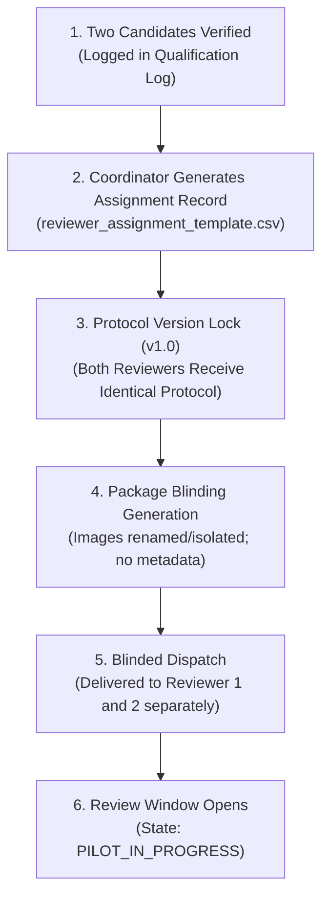

# PahaarPulse — Phase 2M: Pilot Assignment Protocol & Blinding Safeguards

**Document Version:** v1.0  
**Effective Date:** 2026-10-23  
**Project:** PahaarPulse AI/ML Landslide Risk Management System  
**Authority:** Evaluation Working Group & Geotechnical Quality Lead  
**Operational Status:** ASSIGNMENT SPECIFICATION APPROVED (Awaiting Reviewer Recruitment & Qualification)

---

## 1. Executive Summary & Core Principles

This protocol governs the assignment, blinding, data isolation, and custody transfer of field imagery for the PahaarPulse 10-image calibration pilot.

### Core Governance Rules:
1. **Dual Independent Review:** Every image must be evaluated by two independently qualified human reviewers (Reviewer 1 and Reviewer 2).
2. **Strict Pre-Adjudication Isolation:** Neither reviewer may see the other's classifications, confidence ratings, observable indicators, or rationales until their own submission is validated and locked.
3. **Adjudicator Blinding:** The Senior Geotechnical Adjudicator evaluates category mismatches and ambiguous cases with knowledge of the competing geomorphic rationales, but may be blinded to reviewer identity if required by institutional protocol.
4. **Zero Automated Assignments:** No real assignments will be created until qualified humans are recruited, verified against Tier 1/2/3 criteria, and approved by the Human Coordinator.

---

## 2. Pilot Dataset Re-Use & Site / Event Grouping Realities

The pilot utilizes the established 10-candidate dataset from [`PHASE_2J_PILOT_SELECTION.csv`](file:///C:/Users/Swapnanil/Desktop/app2/LRMSG/LRM/docs/gemma-local-vision/evaluation/PHASE_2J_PILOT_SELECTION.csv):

| Pilot ID | Annotation ID | Candidate ID | Geomorphic Category Focus | Site / Event Cluster Group |
| :---: | :---: | :---: | :--- | :--- |
| `PILOT_01` | `ANN_065` | `WMC_37943355` | Acute Rockfall (Roadway Blockage) | `Himachal_Rohtang_Pass_Clearing` |
| `PILOT_02` | `ANN_047` | `WMC_175414035` | Acute Rockslide (Massive Scarp) | `Regional_Site_WMC_175414035` |
| `PILOT_03` | `ANN_040` | `WMC_14428956` | Precursor Tension Cracking | `GPS_53.336810__-3.877200` |
| `PILOT_04` | `ANN_041` | `WMC_148232762` | Precursor Road Subsidence / Distress | `UNKNOWN_SITE_EVENT_WMC_148232762` |
| `PILOT_05` | `ANN_068` | `WMC_43490410` | Intact Retaining Wall (Negative Control) | `GPS_30.598500__-103.917100` |
| `PILOT_06` | `ANN_018` | `WMC_124870041` | Intact Drainage Culvert (Negative Control) | `Regional_Site_WMC_124870041` |
| `PILOT_07` | `ANN_028` | `WMC_133509156` | Intact Pinned Wire Mesh (Negative Control) | `ODOT_Helicopter_Rockfall_Mesh_Series` |
| `PILOT_08` | `ANN_093` | `WMC_89089252` | Contextual Mountain Corridor | `Colorado_Cumberland_Pass` |
| `PILOT_09` | `ANN_050` | `WMC_179395944` | High-Altitude Debris / Boundary Case | `Regional_Site_WMC_179395944` |
| `PILOT_10` | `ANN_014` | `WMC_123141626` | Distant Highway Cut Slope Perspective | `Himachal_Mandi_Kullu_Highway_370_371` |

### 2.1 The Site / Event Independence Limitation
> [!WARNING]
> **Distinct Candidate IDs Do Not Equal Geostatistical Independence:**  
> A fundamental finding of the Phase 2H audit is that different image files may capture the same regional corridor, highway sector, or weather event from different camera angles.
>
> In the pilot cohort:
> - Each of the 10 images belongs to a distinct site/event cluster name in current metadata.
> - However, `UNKNOWN_SITE_EVENT_WMC_148232762` represents an unlocalized scene where spatial independence from other roadside sites cannot be mathematically proven.
> - For future machine learning benchmark splits (train vs. val vs. test), clustering must group by `site_event_group_id` rather than individual `annotation_id`s to prevent spatial data leakage.

---

## 3. Assignment Generation, Recording & Approval Workflow

### Required Transition Evidence to Authorize Review Start:
The pipeline state may only transition from `READY_FOR_PILOT_DISTRIBUTION` to `PILOT_IN_PROGRESS` when all of the following evidence exists:
1. **Verified Reviewers:** Exactly two distinct human reviewers (`REV_A1`, `REV_B2`) logged with approved status in [`reviewer_qualification_log_template.csv`](file:///C:/Users/Swapnanil/Desktop/app2/LRMSG/LRM/docs/gemma-local-vision/evaluation/phase_2k_reviewer_onboarding/reviewer_qualification_log_template.csv).
2. **Approved Assignment Record:** Both reviewers assigned to `PHASE_2J_PILOT_10` under protocol `v1.0` in [`reviewer_assignment_template.csv`](file:///C:/Users/Swapnanil/Desktop/app2/LRMSG/LRM/docs/gemma-local-vision/evaluation/phase_2k_reviewer_onboarding/reviewer_assignment_template.csv).
3. **Signed Consent & Blinding Affirmation:** Both reviewers have signed the consent and confidentiality checklist.
4. **Coordinator Sign-Off:** Human coordinator signs the dispatch authorization.

---

## 4. Handling Incomplete Submissions, Dropouts & Conflicts of Interest

1. **Incomplete Submissions:**
   - Any submission missing categories, timestamps, or geomorphic rationales is rejected by `validate_human_annotations.py`.
   - The coordinator returns the submission with error line numbers for completion.
   - If uncorrected within 48 hours, the assignment is escalated.
2. **Reviewer Dropouts / Unresponsiveness:**
   - If a reviewer becomes unavailable, their partial records are archived and marked `WITHDRAWN`.
   - The backup candidate (`CAND_PLACEHOLDER_03`, assigned as `REV_C3`) is onboarded and given a fresh, independent assignment.
   - Partial annotations from withdrawn reviewers are **never** shown to the replacement reviewer.
3. **Conflict of Interest (COI) Disclosures:**
   - If a reviewer recognizes a site from previous personal work and believes their prior knowledge biases optical classification, they log the conflict in `pilot_issue_log_template.csv`.
   - The non-conflicted reviewer completes their review normally.
   - The item is reassigned to the backup reviewer or escalated directly to the Senior Adjudicator.
