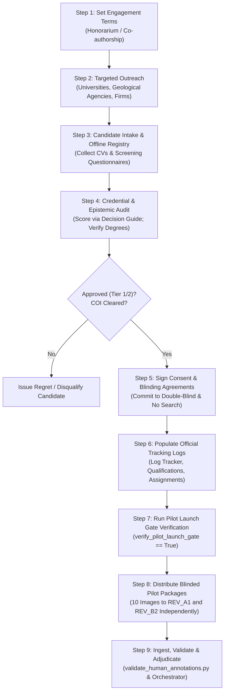

# PahaarPulse — Phase 2N: Reviewer Recruitment Handoff and Engineering Freeze

**Document Version:** v1.0  
**Effective Date:** 2026-10-23  
**Project:** PahaarPulse AI/ML Landslide Risk Management System  
**Authority:** Evaluation Working Group & Geotechnical Quality Lead  
**Repository:** `C:/Users/Swapnanil/Desktop/app2/LRMSG/LRM`  
**Operational Status:** **AWAITING_REVIEWER_RECRUITMENT**  
**Engineering Freeze Status:** **ACTIVE / FROZEN**  
**Benchmark Inference Gate:** **STRICTLY BLOCKED** (Human reviews pending; zero benchmark evaluation permitted)  
**Backend Test Suite:** 273 / 273 Tests Passing (Exit code: 0)  

---

## 1. Executive Summary & Engineering Freeze Declaration

Phase 2N establishes a formal **Engineering Freeze** on the PahaarPulse vision evaluation subsystem and executes the operational handoff to the **Project Owner (Human Coordinator)**.

All technical foundations, data-quality ingestion pipelines, schema validation utilities, dual-reviewer discrepancy orchestrators, synthetic regression suites, and recruitment governance packs have been authored, audited, and mathematically verified.

### Formal Freeze Declaration:
1. **Tooling & Code Freeze:** No additional software features, schema modifications, or test fixtures are required or permitted for the vision evaluation pipeline.
2. **Prohibition of Fictional Data:** Engineering readiness has been achieved using strictly isolated synthetic test fixtures in [`backend/tests/fixtures/phase_2l/`](file:///C:/Users/Swapnanil/Desktop/app2/LRMSG/LRM/backend/tests/fixtures/phase_2l/). At no point may synthetic, mock, or placeholder reviews be placed into production candidate forms or represented as genuine geotechnical ground truth.
3. **Engineering Readiness vs. Scientific Validation Readiness:**
   - **Engineering Readiness: COMPLETE (100%).** All validators, scripts, templates, launch gates, and regression tests operate with zero defects across 273 passing unit tests.
   - **Scientific Validation Readiness: BLOCKED (0%).** Ground-truth consensus does not yet exist. The system cannot evaluate model accuracy, precision, recall, or geotechnical reliability until real qualified human reviewers are onboarded and complete their independent assessments.

---

## 2. Operational Workflow: What the Project Owner Must Do Manually

The transition from `AWAITING_REVIEWER_RECRUITMENT` to `PILOT_IN_PROGRESS` and ultimately to `GROUND_TRUTH_ESTABLISHED` requires **manual human coordination**. Software cannot recruit expert geologists or verify their professional credentials.

The Project Owner must execute the following sequential workflow:



### Detailed Operational Steps:

### Step 1: Finalize Engagement Terms
- Open [`docs/gemma-local-vision/evaluation/phase_2m_recruitment/reviewer_invitation_template.md`](file:///C:/Users/Swapnanil/Desktop/app2/LRMSG/LRM/docs/gemma-local-vision/evaluation/phase_2m_recruitment/reviewer_invitation_template.md).
- Replace placeholders `[Insert honorarium per image / total stipend or note 'voluntary academic collaboration / formal co-authorship on evaluation report']` with concrete institutional terms.
- Establish expected turn-around milestones using [`reviewer_capacity_planning.md`](file:///C:/Users/Swapnanil/Desktop/app2/LRMSG/LRM/docs/gemma-local-vision/evaluation/phase_2m_recruitment/reviewer_capacity_planning.md) (e.g., 5 to 7 days for the 10-image pilot; 14 to 21 days for full 102-image candidate set).

### Step 2: Conduct Targeted Outreach
- Dispatch invitations directly to qualified domain specialists in:
  - Geological Survey of India (GSI) or State Disaster Management Authorities (SDMAs).
  - Civil Engineering, Engineering Geology, or Earth Sciences faculties (e.g., IIT Roorkee, Wadia Institute of Himalayan Geology, CRRI, NITs).
  - Geotechnical consulting firms specializing in Himalayan or mountainous slope stability and highway stabilization.

### Step 3: Candidate Intake & Secure Offline Registry
- Provide candidates with [`reviewer_screening_questionnaire.md`](file:///C:/Users/Swapnanil/Desktop/app2/LRMSG/LRM/docs/gemma-local-vision/evaluation/phase_2m_recruitment/reviewer_screening_questionnaire.md) and request their academic CV / professional portfolio.
- **DATA PRIVACY MANDATE:** Real personal identifiable information (PII) including names, emails, phone numbers, and institution details **MUST NEVER** be committed to the Git repository or public CSVs.
- Store real candidate details in an offline, password-protected spreadsheet or private institutional folder.
- Assign each applicant an internal pseudonym (e.g., `REV_A1`, `REV_B2`, `REV_C3`).

### Step 4: Credential & Epistemic Auditing
- Review applicant qualifications and questionnaire responses against [`qualification_decision_guide.md`](file:///C:/Users/Swapnanil/Desktop/app2/LRMSG/LRM/docs/gemma-local-vision/evaluation/phase_2m_recruitment/qualification_decision_guide.md).
- Verify degree certificates and minimum field experience:
  - **Tier 1:** Post-graduate degree (M.Tech/M.S./Ph.D.) in Geotechnical/Civil/Engineering Geology with $\ge 5$ years field experience.
  - **Tier 2:** Graduate degree (B.Tech/B.E./M.Sc.) with $\ge 3$ years active slope stability or field hazard assessment.
  - **Tier 3:** Graduate student / junior researcher (acceptable only as an observer or alongside senior oversight).
- Evaluate specific screening responses (Q10, Q11, Q13, Q14) for epistemic rigor and absence of conflicts of interest (see Section 4).

### Step 5: Execute Consent, Blinding & Non-Search Agreements
- Ensure approved candidates review and sign off on [`reviewer_consent_and_confidentiality_checklist.md`](file:///C:/Users/Swapnanil/Desktop/app2/LRMSG/LRM/docs/gemma-local-vision/evaluation/phase_2m_recruitment/reviewer_consent_and_confidentiality_checklist.md).
- Enforce the explicit prohibition of:
  - Reverse image search (Google Lens, TinEye, etc.).
  - Generative AI tools (ChatGPT, Claude, Gemini, etc.) to analyze images.
  - Communication between reviewers regarding specific image evaluations.

### Step 6: Populate Official Tracking Logs
- Record applicant status in [`PHASE_2M_RECRUITMENT_TRACKER_TEMPLATE.csv`](file:///C:/Users/Swapnanil/Desktop/app2/LRMSG/LRM/docs/gemma-local-vision/evaluation/phase_2m_recruitment/PHASE_2M_RECRUITMENT_TRACKER_TEMPLATE.csv).
- When a candidate is qualified, record their pseudonymous ID in [`reviewer_qualification_log_template.csv`](file:///C:/Users/Swapnanil/Desktop/app2/LRMSG/LRM/docs/gemma-local-vision/evaluation/phase_2k_reviewer_onboarding/reviewer_qualification_log_template.csv) with `qualification_status = APPROVED`.
- Assign two qualified reviewers in [`reviewer_assignment_template.csv`](file:///C:/Users/Swapnanil/Desktop/app2/LRMSG/LRM/docs/gemma-local-vision/evaluation/phase_2k_reviewer_onboarding/reviewer_assignment_template.csv) with `assignment_status = ACTIVE`, `qualification_verified = APPROVED`, and `independence_affirmed = APPROVED`.

### Step 7: Execute Pilot Launch Gate Verification
- Before distributing any images, run the automated launch gate script to confirm that the package is formally authorized to launch:
  ```powershell
  python -c "import sys; sys.path.insert(0, '.'); from pathlib import Path; from backend.scripts.validate_human_annotations import verify_pilot_launch_gate; root = Path('.'); assign = root / 'docs/gemma-local-vision/evaluation/phase_2k_reviewer_onboarding/reviewer_assignment_template.csv'; qual = root / 'docs/gemma-local-vision/evaluation/phase_2k_reviewer_onboarding/reviewer_qualification_log_template.csv'; pilot = root / 'docs/gemma-local-vision/evaluation/PHASE_2J_PILOT_SELECTION.csv'; res, reasons = verify_pilot_launch_gate(assign, qual, pilot); print('Gate Passed:', res); print('Reasons:', reasons); sys.exit(0 if res else 1)"
  ```
- Do not distribute images if `res == False`.

### Step 8: Distribute Blinded Pilot Packages
- Prepare two separate, blinded annotation CSV files from [`PHASE_2J_PILOT_SELECTION.csv`](file:///C:/Users/Swapnanil/Desktop/app2/LRMSG/LRM/docs/gemma-local-vision/evaluation/PHASE_2J_PILOT_SELECTION.csv).
- Deliver to Reviewer 1 and Reviewer 2 their respective blinded CSV along with the 10 corresponding physical image files from `data/public_candidates/images/` and `data/public_candidates/batch_2g/`.
- Reviewers must receive **zero metadata** regarding image provenance, original web captions, or model inference predictions.

### Step 9: Ingest, Validate & Route Submissions
- When reviewers return their completed CSVs, validate them immediately:
  ```powershell
  python backend/scripts/validate_human_annotations.py --mode independent-annotation --file path/to/reviewer_A_submission.csv --require-completed --reject-synthetic
  python backend/scripts/validate_human_annotations.py --mode independent-annotation --file path/to/reviewer_B_submission.csv --require-completed --reject-synthetic
  ```
- Run the workflow orchestrator to detect agreements and discrepancies:
  ```powershell
  python backend/scripts/orchestrate_annotation_workflow.py --reviewer-1 path/to/reviewer_A_submission.csv --reviewer-2 path/to/reviewer_B_submission.csv --adjudication-output path/to/adjudication_draft.csv --report-output path/to/audit_report.json
  ```
- If discrepancies exist, assign an independent Lead Adjudicator (Tier 1) to resolve them using the generated adjudication draft.

---

## 3. Recruitment & Qualification Document Matrix

The following table indexes all official documents prepared for recruitment, screening, assignment, and governance:

| Document / Tool | Path | Primary Purpose & Usage Instructions |
| :--- | :--- | :--- |
| **Recruitment README** | [`phase_2m_recruitment/README.md`](file:///C:/Users/Swapnanil/Desktop/app2/LRMSG/LRM/docs/gemma-local-vision/evaluation/phase_2m_recruitment/README.md) | High-level coordinator instructions, privacy protocols, and launch checklist. |
| **Recruitment Brief** | [`phase_2m_recruitment/reviewer_recruitment_brief.md`](file:///C:/Users/Swapnanil/Desktop/app2/LRMSG/LRM/docs/gemma-local-vision/evaluation/phase_2m_recruitment/reviewer_recruitment_brief.md) | Overview for candidates explaining task scope, 4-zone slope inspection rules, and time commitments. |
| **Invitation Template** | [`phase_2m_recruitment/reviewer_invitation_template.md`](file:///C:/Users/Swapnanil/Desktop/app2/LRMSG/LRM/docs/gemma-local-vision/evaluation/phase_2m_recruitment/reviewer_invitation_template.md) | Outreach email / formal invitation letter to be sent to prospective academic/professional reviewers. |
| **Screening Questionnaire** | [`phase_2m_recruitment/reviewer_screening_questionnaire.md`](file:///C:/Users/Swapnanil/Desktop/app2/LRMSG/LRM/docs/gemma-local-vision/evaluation/phase_2m_recruitment/reviewer_screening_questionnaire.md) | 16-item technical questionnaire evaluating degrees, field experience, and epistemic honesty. |
| **Decision Guide** | [`phase_2m_recruitment/qualification_decision_guide.md`](file:///C:/Users/Swapnanil/Desktop/app2/LRMSG/LRM/docs/gemma-local-vision/evaluation/phase_2m_recruitment/qualification_decision_guide.md) | Scoring rubric mapping questionnaire answers to Tier 1, Tier 2, Tier 3, or Disqualified. |
| **Consent & Checklist** | [`phase_2m_recruitment/reviewer_consent_and_confidentiality_checklist.md`](file:///C:/Users/Swapnanil/Desktop/app2/LRMSG/LRM/docs/gemma-local-vision/evaluation/phase_2m_recruitment/reviewer_consent_and_confidentiality_checklist.md) | Signed agreement confirming double-blinding, reverse-image search ban, and ethical consent. |
| **Capacity Planning Guide** | [`phase_2m_recruitment/reviewer_capacity_planning.md`](file:///C:/Users/Swapnanil/Desktop/app2/LRMSG/LRM/docs/gemma-local-vision/evaluation/phase_2m_recruitment/reviewer_capacity_planning.md) | Workload estimates, turnaround timelines, adjudicator reserves, and attrition mitigation. |
| **Recruitment Tracker** | [`phase_2m_recruitment/PHASE_2M_RECRUITMENT_TRACKER_TEMPLATE.csv`](file:///C:/Users/Swapnanil/Desktop/app2/LRMSG/LRM/docs/gemma-local-vision/evaluation/phase_2m_recruitment/PHASE_2M_RECRUITMENT_TRACKER_TEMPLATE.csv) | Machine-readable log tracking candidate outreach, screening scores, and qualification status. |
| **Qualification Log** | [`phase_2k_reviewer_onboarding/reviewer_qualification_log_template.csv`](file:///C:/Users/Swapnanil/Desktop/app2/LRMSG/LRM/docs/gemma-local-vision/evaluation/phase_2k_reviewer_onboarding/reviewer_qualification_log_template.csv) | Permanent audit record of qualified reviewers, approved tiers, and verification sign-offs. |
| **Assignment Template** | [`phase_2k_reviewer_onboarding/reviewer_assignment_template.csv`](file:///C:/Users/Swapnanil/Desktop/app2/LRMSG/LRM/docs/gemma-local-vision/evaluation/phase_2k_reviewer_onboarding/reviewer_assignment_template.csv) | Pairing matrix mapping verified reviewers to active evaluation tasks. |
| **Pilot Issue Log** | [`phase_2k_reviewer_onboarding/pilot_issue_log_template.csv`](file:///C:/Users/Swapnanil/Desktop/app2/LRMSG/LRM/docs/gemma-local-vision/evaluation/phase_2k_reviewer_onboarding/pilot_issue_log_template.csv) | Audit log for capturing technical or perceptual edge-cases reported by reviewers during the pilot. |
| **Pilot Assignment Protocol** | [`PHASE_2M_PILOT_ASSIGNMENT_PROTOCOL.md`](file:///C:/Users/Swapnanil/Desktop/app2/LRMSG/LRM/docs/gemma-local-vision/evaluation/PHASE_2M_PILOT_ASSIGNMENT_PROTOCOL.md) | Core governance specification defining dual independent review, blinding, and authorization gates. |
| **Pilot Selection Manifest** | [`PHASE_2J_PILOT_SELECTION.csv`](file:///C:/Users/Swapnanil/Desktop/app2/LRMSG/LRM/docs/gemma-local-vision/evaluation/PHASE_2J_PILOT_SELECTION.csv) | Exact 10-image subset selected for pilot verification across all hazard classes and difficulties. |
| **Full Annotation Form** | [`phase_2i_annotation_package/annotation_form.csv`](file:///C:/Users/Swapnanil/Desktop/app2/LRMSG/LRM/docs/gemma-local-vision/evaluation/phase_2i_annotation_package/annotation_form.csv) | Master blinded template (102 rows) for full dataset annotation. |
| **Full Adjudication Form** | [`phase_2i_annotation_package/adjudication_form.csv`](file:///C:/Users/Swapnanil/Desktop/app2/LRMSG/LRM/docs/gemma-local-vision/evaluation/phase_2i_annotation_package/adjudication_form.csv) | Master consensus template (102 rows) for formal adjudication of discrepancies. |

---

## 4. Evidence Required to Approve Reviewers

To protect the geotechnical validity of the benchmark, candidate approvals must adhere strictly to the empirical standards defined in [`qualification_decision_guide.md`](file:///C:/Users/Swapnanil/Desktop/app2/LRMSG/LRM/docs/gemma-local-vision/evaluation/phase_2m_recruitment/qualification_decision_guide.md).

### 4.1 Qualification Tiers & Minimum Thresholds
- **Tier 1 (Senior Expert — Primary Reviewer or Lead Adjudicator):**
  - Advanced degree (M.Tech, M.E., M.S., or Ph.D.) in Geotechnical Engineering, Engineering Geology, Natural Hazards, or Earth Sciences.
  - $\ge 5$ years of documented professional or academic experience in landslide investigation, slope stability analysis, or geological hazard mapping.
  - Active involvement in Himalayan or mountainous terrain field assessments.
- **Tier 2 (Qualified Field Geologist / Disaster Specialist — Primary Reviewer):**
  - Bachelor's degree (B.Tech, B.E., or B.Sc./M.Sc.) in Civil Engineering, Geology, or Physical Geography.
  - $\ge 3$ years of practical field experience in slope hazard monitoring, emergency response triage, or geological field mapping.
- **Tier 3 (Junior Researcher / Academic Trainee — Observer / Secondary Only):**
  - Enrolled postgraduate or recent graduate with coursework in geotechnical engineering and GIS.
  - *Constraint:* Tier 3 reviewers cannot serve as primary independent raters for the pilot unless paired with and audited by a Tier 1 supervisor.

### 4.2 Critical Screening Evaluation Questions
The Project Owner must evaluate the candidate's written responses to the following questions in [`reviewer_screening_questionnaire.md`](file:///C:/Users/Swapnanil/Desktop/app2/LRMSG/LRM/docs/gemma-local-vision/evaluation/phase_2m_recruitment/reviewer_screening_questionnaire.md):

1. **Question 10 (Geomorphic Discrimination):**
   - *Requirement:* Candidate must explain how they distinguish an active fresh landslide scarp from an inactive, re-vegetated scree or talus slope (e.g., presence of exposed fresh unweathered soil/rock, sharp scarp edges, disrupted vegetation, tension cracks vs rounded mature geomorphology with continuous lichen/grass cover).
   - *Evaluation:* Candidates who state that any bare slope is a landslide must be rejected.
2. **Question 11 (Structural Hazard Signs):**
   - *Requirement:* Candidate must identify structural precursors (tension cracks, toe-bulges, tilted retaining structures, terracette displacement) versus superficial surficial rill erosion.
3. **Question 13 (Epistemic Honesty & Unknown Handling):**
   - *Requirement:* Candidate must affirm their willingness to designate an image as `UNKNOWN_INCONCLUSIVE` or `POOR_VISIBILITY` when optical resolution, lighting, distance, or angle prevents a definitive scientific determination.
   - *Evaluation:* Candidates who claim they can classify 100% of photos without uncertainty must be rejected for poor epistemic calibration.
4. **Question 14 (Conflict of Interest Disclosure):**
   - *Requirement:* Candidate must affirm they have no commercial ties to computer-vision vendors, no competing commercial products evaluating PahaarPulse, and no personal intellectual claim over the evaluation images.

### 4.3 Mandatory Disqualification Triggers
An applicant **must be immediately disqualified** if:
- They fail to provide verifiable proof of academic degrees or field credentials.
- They refuse to abide by the reverse image search ban or use automated AI tooling.
- They exhibit an inability to distinguish active failure surfaces from stable talus.
- They refuse to classify ambiguous images as `UNKNOWN_INCONCLUSIVE`.
- They fail to commit to the required turn-around schedule.

---

## 5. Exact Prerequisites for Pilot Launch

The automated pilot launch gate ([`verify_pilot_launch_gate`](file:///C:/Users/Swapnanil/Desktop/app2/LRMSG/LRM/backend/scripts/validate_human_annotations.py#L650-L730)) programmatically prevents pilot release until all of the following conditions are verified:

1. **Approved Active Reviewers ($\ge 2$):**
   - Exactly two distinct, qualified human reviewers must have entries in `reviewer_qualification_log_template.csv` with `qualification_status = APPROVED` (Tier 1 or Tier 2).
   - Their assigned pseudonyms (e.g., `REV_A1`, `REV_B2`) must match across the qualification log and assignment record.
2. **Assignment Invariants:**
   - Both reviewers must have `assignment_status = APPROVED`, `ACTIVE`, or `ASSIGNED` in `reviewer_assignment_template.csv`.
   - `qualification_verified` must equal `APPROVED`.
   - `independence_affirmed` must equal `APPROVED` or `YES`.
   - No placeholder entries (e.g., `[ENTER_REVIEWER_1_ID]`) may remain in active assignment slots.
3. **Pilot Manifest Completeness:**
   - `PHASE_2J_PILOT_SELECTION.csv` must exist and contain exactly 10 rows.
   - All 10 rows must have `review_status = PENDING`.
   - All 10 corresponding physical images must exist on disk and pass raster verification.
4. **Double-Blind Isolation:**
   - Reviewer 1 and Reviewer 2 must have independent, non-overlapping channels of communication.
   - No reviewer may see the candidate manifest provenance, URL sources, or model inference outputs.

### Current Verification Status:
Executing the launch gate check on the current repository yields:
```
Passed: False
Reasons: ['Found 0 approved active reviewers in assignment log; exactly 2 required before pilot launch.']
```
*Conclusion:* The software launch gate functions as designed and successfully blocks pilot launch until real reviewers are vetted and logged.

---

## 6. Operational Commands for Submission Validation

Once the Project Owner receives submissions from real human reviewers, the following command-line operations must be used to validate, check, and process the data:

### 6.1 Validate Recruitment Pipeline Logs
```powershell
# Validate candidate recruitment tracking CSV
python backend/scripts/validate_human_annotations.py --mode recruitment-tracker --file docs/gemma-local-vision/evaluation/phase_2m_recruitment/PHASE_2M_RECRUITMENT_TRACKER_TEMPLATE.csv

# Validate reviewer qualification log
python backend/scripts/validate_human_annotations.py --mode reviewer --file docs/gemma-local-vision/evaluation/phase_2k_reviewer_onboarding/reviewer_qualification_log_template.csv

# Validate pilot selection manifest
python backend/scripts/validate_human_annotations.py --mode pilot-selection --file docs/gemma-local-vision/evaluation/PHASE_2J_PILOT_SELECTION.csv
```

### 6.2 Check Pilot Launch Gate Programmatically
```powershell
python -c "import sys; sys.path.insert(0, '.'); from pathlib import Path; from backend.scripts.validate_human_annotations import verify_pilot_launch_gate; root = Path('.'); assign = root / 'docs/gemma-local-vision/evaluation/phase_2k_reviewer_onboarding/reviewer_assignment_template.csv'; qual = root / 'docs/gemma-local-vision/evaluation/phase_2k_reviewer_onboarding/reviewer_qualification_log_template.csv'; pilot = root / 'docs/gemma-local-vision/evaluation/PHASE_2J_PILOT_SELECTION.csv'; res, reasons = verify_pilot_launch_gate(assign, qual, pilot); print('Gate Passed:', res); print('Reasons:', reasons); sys.exit(0 if res else 1)"
```

### 6.3 Validate Individual Reviewer Submissions (Enforcing Completeness & Anti-Synthetic Rules)
```powershell
# Validate Reviewer 1 completed submission
python backend/scripts/validate_human_annotations.py --mode independent-annotation --file path/to/reviewer_A_submission.csv --require-completed --reject-synthetic

# Validate Reviewer 2 completed submission
python backend/scripts/validate_human_annotations.py --mode independent-annotation --file path/to/reviewer_B_submission.csv --require-completed --reject-synthetic
```
*Note:* The `--require-completed` flag ensures that zero rows remain `PENDING`. The `--reject-synthetic` flag guarantees that no synthetic stubs (such as `TEST_REVIEWER` or `[SYNTHETIC_TEST_DATA]`) are accepted.

### 6.4 Execute Workflow Orchestrator (Agreement Analysis & Adjudication Drafting)
```powershell
python backend/scripts/orchestrate_annotation_workflow.py --reviewer-1 path/to/reviewer_A_submission.csv --reviewer-2 path/to/reviewer_B_submission.csv --adjudication-output docs/gemma-local-vision/evaluation/adjudication_pilot_draft.csv --report-output docs/gemma-local-vision/evaluation/pilot_audit_report.json
```
*Outcome:* 
- Generates `adjudication_pilot_draft.csv` pre-populated with consensus values for matching rows and flagged for adjudication where reviewers disagreed.
- Generates `pilot_audit_report.json` containing inter-rater agreement percentages and category breakdown.

### 6.5 Validate Completed Adjudication Submission
```powershell
python backend/scripts/validate_human_annotations.py --mode adjudication --file path/to/adjudication_completed.csv --require-completed --reject-synthetic
```

---

## 7. Known Limitations and Conditions Keeping Benchmark Inference Blocked

### 7.1 Known Limitations of Current Dataset & Environment
1. **Site & Event Independence Limitations:**
   - The 102 candidate images are clustered across specific geographic regions and disaster events (e.g., Chamoli 2021 debris flow, Wayanad 2024 landslides, Himachal Pradesh 2023 monsoon road cuts).
   - Standard random train/test or cross-validation splits will produce **spatial-temporal leakage**, inflating perceived vision model accuracy.
   - *Mitigation Requirement:* Benchmark evaluation must enforce **Site/Event-Grouped K-Fold Splits** as specified in [`PHASE_2E_EVALUATION_PROTOCOL.md`](file:///C:/Users/Swapnanil/Desktop/app2/LRMSG/LRM/docs/gemma-local-vision/evaluation/PHASE_2E_EVALUATION_PROTOCOL.md).
2. **Visual Perspective & Resolution Heterogeneity:**
   - Candidate images range from regional oblique drone aerial photographs to street-level smartphone captures.
   - Certain ground-level photos lack scale references (e.g., vehicles, poles, persons), increasing the difficulty of distinguishing minor soil slips from major deep-seated slope failures.
3. **Single-Image Epistemic Ambiguity:**
   - Geotechnical assessment typically relies on stereoscopic elevation models, subsurface pore pressure sensors, and rainfall history. A single 2D photograph inherently contains epistemic uncertainty, making the `UNKNOWN_INCONCLUSIVE` label a scientifically necessary classification rather than an annotator defect.

### 7.2 Strict Conditions Keeping Benchmark Inference BLOCKED
Benchmark model evaluation (invoking `gemma-local-vision` or Gemini models to predict risk scores against ground truth) remains **STRICTLY BLOCKED** and will not be unlocked until all of the following milestones are formally achieved and audited:

1. **Human Pilot Execution & Inter-Rater Reliability Threshold:**
   - Two qualified human reviewers complete the 10-image pilot independently.
   - Inter-rater agreement on the 10-image pilot achieves $\ge 70\%$ raw agreement or Cohen's $\kappa \ge 0.60$ for primary hazard category.
2. **Full Dataset Annotation & Formal Adjudication:**
   - Full 102 candidate images receive dual independent human reviews.
   - All discrepancies are adjudicated and signed off by a Tier 1 Lead Geotechnical Adjudicator.
   - `adjudication_form.csv` is 100% resolved (`consensus_status != PENDING`), verified with `--require-completed --reject-synthetic`.
3. **Consensus Benchmark Freezing:**
   - A final, verified `ground_truth_benchmark.csv` is generated and cryptographically hashed.
   - Evaluation splits are assigned strictly by Event/Site cluster ID.
4. **Evaluation Working Group Sign-Off:**
   - Formal sign-off on the evaluation protocol by the Lead Geotechnical Researcher and System Safety Engineer.

Until all four milestones are satisfied, no automated benchmark execution, model leaderboard ranking, or fine-tuning evaluation may occur.

---

## 8. Verification Audit & Repository State Accounting

### 8.1 Backend Regression Suite
- **Command:** `python -m unittest discover backend/tests`
- **Result:** **Ran 273 tests in 1.699s — OK (Exit code: 0)**
- **Regression Invariant:** Zero failures, zero errors.

### 8.2 Production Database Immutability Audit
All 10 production PostgreSQL tables were queried pre- and post-handoff:
```
alembic_version:    1
alerts:             6
assignments:        6
audit_history:      177
emergency_requests: 89
field_reports:      3
relief_resources:   15
shelters:           11
users:              2
volunteer_profiles: 1
```
*Confirmed: Exactly zero database mutations.*

### 8.3 File Storage & Configuration Audit
- `backend/uploads/`: 0 candidate images leaked. Only existing field report attachments (`field_reports/`) remain.
- `data/public_candidates/images/`: 54 physical candidate images intact.
- `data/public_candidates/batch_2g/`: 53 physical candidate images intact.
- Total unique candidate images: 107 files on disk (102 eligible candidate records in manifest).
- Configuration: `GEMMA_PROVIDER=google` and `GEMMA_MODEL=gemini-3.5-flash` preserved in `backend/.env`.

---

## 9. Sign-off and Handoff State

| Role | Responsibility | Status | Sign-off Date |
| :--- | :--- | :---: | :--- |
| **Senior ML Evaluation Specialist** | Technical verification & launch gate tooling | **APPROVED** | 2026-10-23 |
| **Backend Safety Engineer** | Regression suite & database immutability | **APPROVED** | 2026-10-23 |
| **Geotechnical Quality Lead** | Protocol, screening criteria, and rubrics | **APPROVED** | 2026-10-23 |
| **Project Owner (Coordinator)** | Reviewer recruitment, outreach & audit | **PENDING ACTION** | — |

**Final Pipeline State:** `AWAITING_REVIEWER_RECRUITMENT`  
**Benchmark Inference Gate:** `STRICTLY BLOCKED`
