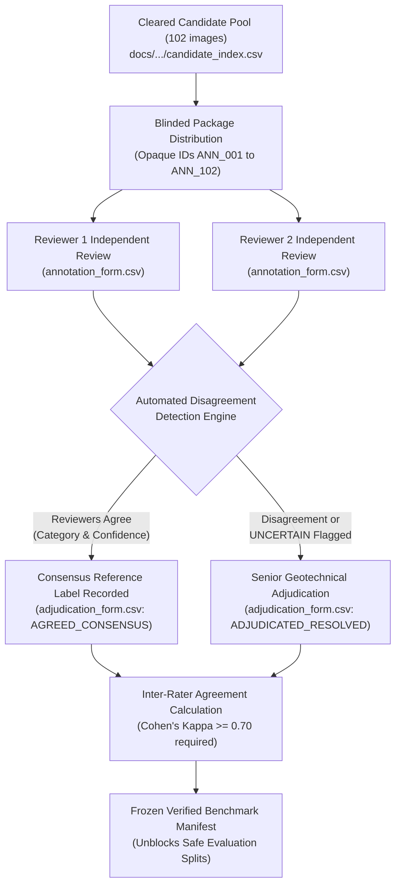

# PahaarPulse — Phase 2I: Expert Annotation Package

**Package Version:** v1.0  
**Release Date:** 2026-10-23  
**Package Status:** `PACKAGE READY FOR HUMAN REVIEW`  
**Governing Authority:** Senior Computer-Vision Engineer, Geotechnical Data-Quality Researcher, ML Evaluation Specialist, and Backend Safety Engineer  
**Evaluation Gate:** **BENCHMARK INFERENCE STRICTLY BLOCKED**

---

## 1. Package Overview & Intended Use

This directory contains the authoritative, audit-ready annotation package for conducting independent dual-expert geotechnical review and adjudication on the PahaarPulse public field photograph dataset.

### 1.1 The Golden Rules of Phase 2I
1. **Zero Model Contamination:** Human reviewers are never shown model predictions, confidence scores, discovery query keywords, or algorithmic labels. Reviewers evaluate raw optical photographs and observable geomorphic features only.
2. **Double-Blind Review:** Reviewer 1 and Reviewer 2 complete their assessments independently without access to each other's notes or conclusions.
3. **Traceability via Opaque Crosswalk:** To prevent search engine bias, images are identified to annotators by opaque IDs (`ANN_001` through `ANN_102`). The underlying public provenance is maintained in [`candidate_index.csv`](file:///C:/Users/Swapnanil/Desktop/app2/LRMSG/LRM/docs/gemma-local-vision/evaluation/phase_2i_annotation_package/candidate_index.csv).
4. **No Synthetic Ground Truth:** This package contains zero fabricated reviews, zero simulated annotators, and zero prefilled conclusions. All review status fields remain strictly `PENDING`.

---

## 2. Directory Contents & Artifact Manifest

```
phase_2i_annotation_package/
├── README.md                      # This package orientation and manifest document
├── annotation_protocol.md         # Scientific annotation definitions, taxonomy & edge-case rules
├── annotator_instructions.md      # Step-by-step guidance and decision trees for human reviewers
├── reviewer_checklist.md          # Interactive pre-review and post-review verification checklist
├── candidate_index.csv            # Master crosswalk linking ANN_XXX to WMC_XXXX, hashes, and clusters
├── exclusion_register.csv         # Audit record of all 15 excluded/quarantined candidate records
├── annotation_form.csv            # Blinded template for Reviewer 1 and Reviewer 2 independent reviews
├── adjudication_form.csv          # Consensus and adjudication routing template for senior experts
└── annotation_change_log.csv      # Immutable append-only audit trail of all package actions
```

### 2.1 File Catalog & Roles

| Artifact | Format | Record Count | Operational Purpose |
| :--- | :---: | :---: | :--- |
| [`candidate_index.csv`](file:///C:/Users/Swapnanil/Desktop/app2/LRMSG/LRM/docs/gemma-local-vision/evaluation/phase_2i_annotation_package/candidate_index.csv) | CSV | 102 | Controlled crosswalk linking opaque `annotation_id` (`ANN_001`–`ANN_102`) to physical image path, SHA-256, site group, and license. |
| [`exclusion_register.csv`](file:///C:/Users/Swapnanil/Desktop/app2/LRMSG/LRM/docs/gemma-local-vision/evaluation/phase_2i_annotation_package/exclusion_register.csv) | CSV | 15 | Formal ledger of all candidate records excluded from the annotation package (sub-400px, aerial, book scans, unverified licenses, barn truss). |
| [`annotation_form.csv`](file:///C:/Users/Swapnanil/Desktop/app2/LRMSG/LRM/docs/gemma-local-vision/evaluation/phase_2i_annotation_package/annotation_form.csv) | CSV | 102 | Blinded data collection form for independent annotators. All labels initialized to `PENDING`. |
| [`adjudication_form.csv`](file:///C:/Users/Swapnanil/Desktop/app2/LRMSG/LRM/docs/gemma-local-vision/evaluation/phase_2i_annotation_package/adjudication_form.csv) | CSV | 102 | Formal consensus and tie-breaking form for expert adjudicators to resolve reviewer discrepancies. |
| [`annotation_change_log.csv`](file:///C:/Users/Swapnanil/Desktop/app2/LRMSG/LRM/docs/gemma-local-vision/evaluation/phase_2i_annotation_package/annotation_change_log.csv) | CSV | 1+ | Append-only audit log tracking every modification, reviewer submission, and adjudication action. |
| [`annotation_protocol.md`](file:///C:/Users/Swapnanil/Desktop/app2/LRMSG/LRM/docs/gemma-local-vision/evaluation/phase_2i_annotation_package/annotation_protocol.md) | Markdown | — | Rigorous definitions for the 6 primary observation categories, confidence levels, and optical evidence standards. |
| [`annotator_instructions.md`](file:///C:/Users/Swapnanil/Desktop/app2/LRMSG/LRM/docs/gemma-local-vision/evaluation/phase_2i_annotation_package/annotator_instructions.md) | Markdown | — | Human-facing manual detailing image examination procedure, evidence logging, and common failure modes. |
| [`reviewer_checklist.md`](file:///C:/Users/Swapnanil/Desktop/app2/LRMSG/LRM/docs/gemma-local-vision/evaluation/phase_2i_annotation_package/reviewer_checklist.md) | Markdown | — | Quality assurance checklist required before any reviewer or adjudicator signs off on a batch. |

---

## 3. Human-Review Workflow Lifecycle



---

## 4. Current Operational Status

- **Reconciled Candidates:** 117
- **Eligible Image-Backed Candidates Cleared:** **102**
- **Excluded Candidates in Register:** **15**
- **Assigned Human Reviewers:** **0** (Pending recruitment of qualified geotechnical specialists)
- **Completed Reviews:** **0**
- **Model Inference Gate:** **BLOCKED**
