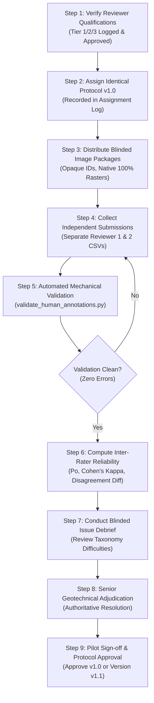

# PahaarPulse — 10-Image Pilot Execution Protocol

**Document Version:** v1.0  
**Effective Date:** 2026-10-23  
**Target Batch:** Phase 2J Pilot Dataset ($N=10$ images, `PILOT_01` to `PILOT_10`)  
**Project:** PahaarPulse AI/ML Landslide Risk Management System  
**Status:** WORKFLOW PROTOCOL DEFINED (Awaiting Reviewer Recruitment & Qualification)

---

## 1. Pilot Mission & Non-Performance Scope

The 10-image pilot is designed exclusively to:
1. Validate the end-to-end human evaluation operational pipeline under live conditions.
2. Test the clarity, completeness, and boundary edge cases of the 6-class geomorphic taxonomy.
3. Test submission validation tooling ([`validate_human_annotations.py`](file:///C:/Users/Swapnanil/Desktop/app2/LRMSG/LRM/backend/scripts/validate_human_annotations.py)).
4. Test inter-rater disagreement detection and adjudication escalation workflows.

> [!WARNING]
> **Not a Model Performance Evaluation:**  
> The 10-image pilot is **not** an evaluation of the Gemma VLM, nor does it establish statistical accuracy claims. No AI inference will be run against this pilot. Benchmark model inference remains strictly **BLOCKED**.

---

## 2. Pilot Image Cohort Composition & Deduplication Audit

The 10 pilot images are drawn from [`docs/gemma-local-vision/evaluation/PHASE_2J_PILOT_SELECTION.csv`](file:///C:/Users/Swapnanil/Desktop/app2/LRMSG/LRM/docs/gemma-local-vision/evaluation/PHASE_2J_PILOT_SELECTION.csv):

| Pilot ID | Annotation ID | Candidate ID | Geomorphic Category Focus | Site / Event Cluster Group | SHA-256 Distinctness |
| :---: | :---: | :---: | :--- | :--- | :---: |
| `PILOT_01` | `ANN_065` | `WMC_37943355` | Acute Rockfall (Roadway Blockage) | `Himachal_Rohtang_Pass_Clearing` | Unique Hash (1/10) |
| `PILOT_02` | `ANN_047` | `WMC_175414035` | Acute Rockslide (Massive Scarp) | `Regional_Site_WMC_175414035` | Unique Hash (2/10) |
| `PILOT_03` | `ANN_040` | `WMC_14428956` | Precursor Tension Cracking | `GPS_53.336810__-3.877200` | Unique Hash (3/10) |
| `PILOT_04` | `ANN_041` | `WMC_148232762` | Precursor Road Subsidence / Distress | `UNKNOWN_SITE_EVENT_WMC_148232762` | Unique Hash (4/10) |
| `PILOT_05` | `ANN_068` | `WMC_43490410` | Intact Retaining Wall (Negative Control) | `GPS_30.598500__-103.917100` | Unique Hash (5/10) |
| `PILOT_06` | `ANN_018` | `WMC_124870041` | Intact Drainage Culvert (Negative Control) | `Regional_Site_WMC_124870041` | Unique Hash (6/10) |
| `PILOT_07` | `ANN_028` | `WMC_133509156` | Intact Pinned Wire Mesh (Negative Control) | `ODOT_Helicopter_Rockfall_Mesh_Series` | Unique Hash (7/10) |
| `PILOT_08` | `ANN_093` | `WMC_89089252` | Contextual Mountain Corridor | `Colorado_Cumberland_Pass` | Unique Hash (8/10) |
| `PILOT_09` | `ANN_050` | `WMC_179395944` | High-Altitude Debris / Boundary Case | `Regional_Site_WMC_179395944` | Unique Hash (9/10) |
| `PILOT_10` | `ANN_014` | `WMC_123141626` | Distant Highway Cut Slope Perspective | `Himachal_Mandi_Kullu_Highway_370_371` | Unique Hash (10/10) |

### 2.1 Cross-Batch Audit & Dependency Check
- **Zero Within-Pilot Redundancy:** All 10 pilot images belong to 10 distinct site/event groups. There is zero spatial or event co-dependence among the 10 images.
- **Cross-Batch Duplication Invariant:** While `ANN_065` and `ANN_040` possess duplicate duplicate files in legacy batch folders, only one unique SHA-256 hash was included in the candidate index and pilot selection.

---

## 3. Strict Nine-Step Pilot Execution Sequence

### Detailed Sequence Descriptions:

1. **Step 1: Verify Reviewer Qualifications:** Qualified candidates submit credentials. Evaluation Lead signs off on Tier assignment and logs entry in [`reviewer_qualification_log_template.csv`](file:///C:/Users/Swapnanil/Desktop/app2/LRMSG/LRM/docs/gemma-local-vision/evaluation/phase_2k_reviewer_onboarding/reviewer_qualification_log_template.csv).
2. **Step 2: Assign Protocol Version:** Both Reviewer 1 and Reviewer 2 are formally assigned protocol version `v1.0` in [`reviewer_assignment_template.csv`](file:///C:/Users/Swapnanil/Desktop/app2/LRMSG/LRM/docs/gemma-local-vision/evaluation/phase_2k_reviewer_onboarding/reviewer_assignment_template.csv).
3. **Step 3: Distribute Blinded Packages:** Reviewers receive blinded images (`PILOT_01` to `PILOT_10` or `ANN_XXX`) without search tags, GPS, or model outputs.
4. **Step 4: Independent Evaluation:** Reviewers conduct evaluations independently using the 4-zone visual inspection procedure and populate their respective `annotation_form_<REVIEWER_ID>.csv`.
5. **Step 5: Mechanical Validation:** Submissions are validated via `backend/scripts/validate_human_annotations.py --mode independent-annotation --require-completed`.
6. **Step 6: Reliability Calculation:** The system computes raw percent agreement $P_o$ and Cohen's Kappa $\kappa$. Discordant rows are flagged.
7. **Step 7: Protocol Issue Review:** Reviewers log feedback on image quality, scale ambiguity, or boundary definitions in [`pilot_issue_log_template.csv`](file:///C:/Users/Swapnanil/Desktop/app2/LRMSG/LRM/docs/gemma-local-vision/evaluation/phase_2k_reviewer_onboarding/pilot_issue_log_template.csv). Blinding is maintained; reviewers do not see each other's individual classifications.
8. **Step 8: Authoritative Adjudication:** Senior Geotechnical Adjudicator (`ADJ_LEAD`) evaluates discordant or uncertain cases, records adjudicated category and rationale, and populates `adjudication_form.csv`.
9. **Step 9: Protocol Refinement or Approval:** If $\kappa \ge 0.70$ and taxonomy ambiguities are minor, Protocol `v1.0` is approved for the full 102-image cohort. If significant ambiguities emerged, amendments are drafted (`v1.1`) and re-calibrated.

---

## 4. Integrity Safeguards

- **Zero Fabricated Records:** No reviewer names, categories, or reliability metrics will be recorded until real humans execute the review.
- **Dry-Run Safety:** Ingestion and validation scripts execute in read-only mode by default without database interaction.
- **Model Gate:** Benchmark model inference remains strictly blocked.
